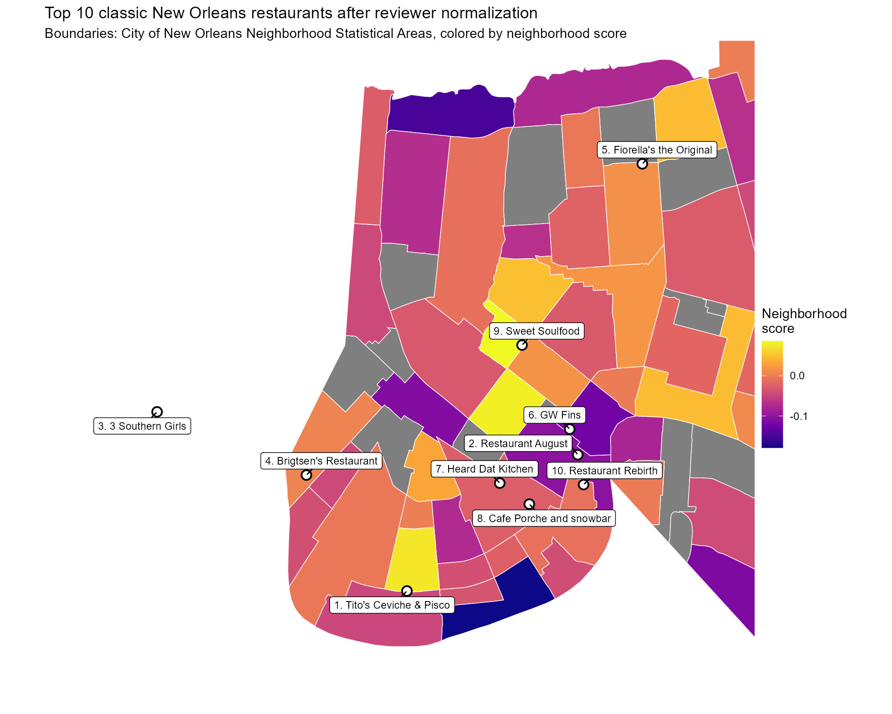
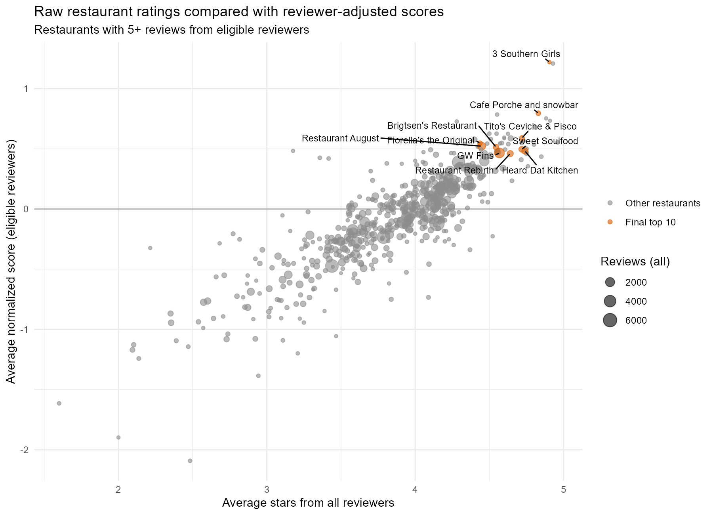
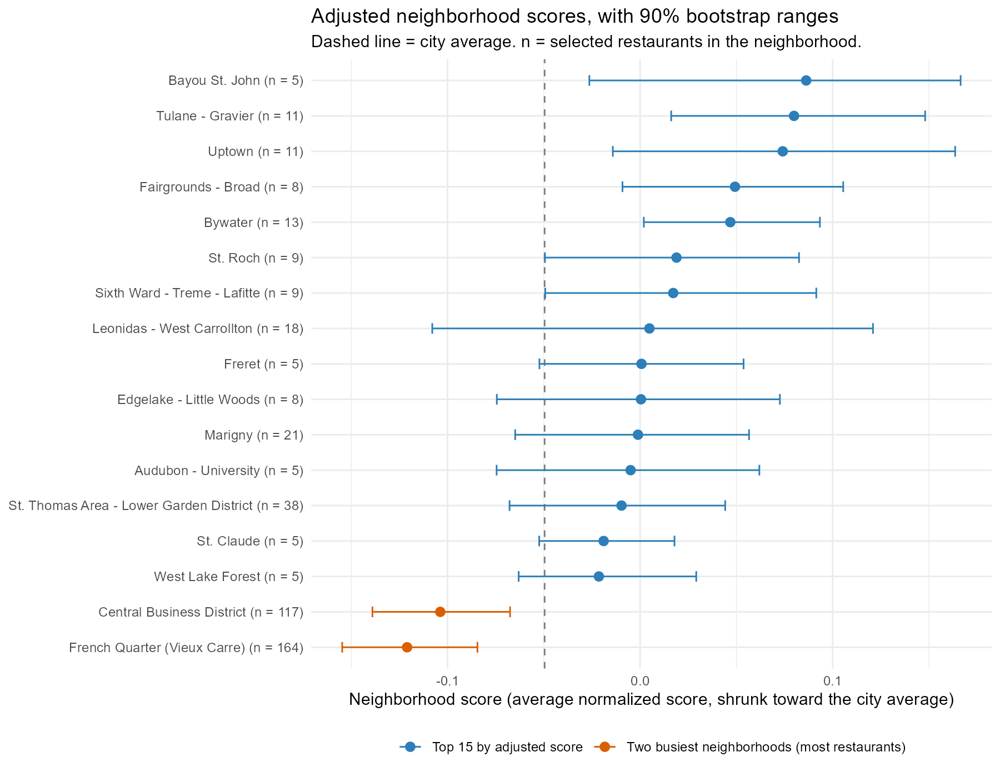
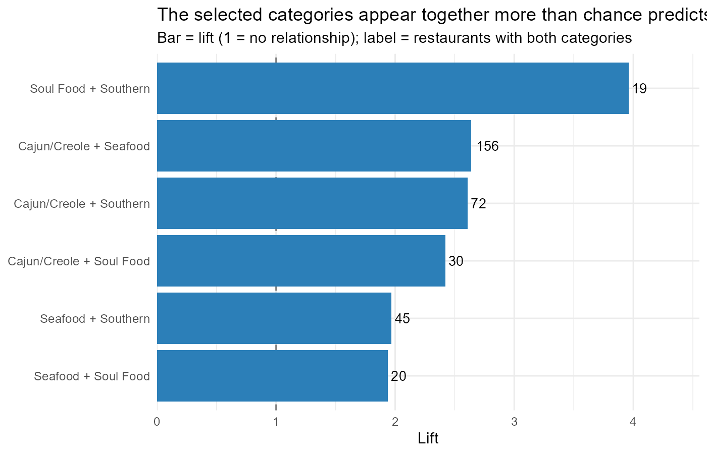
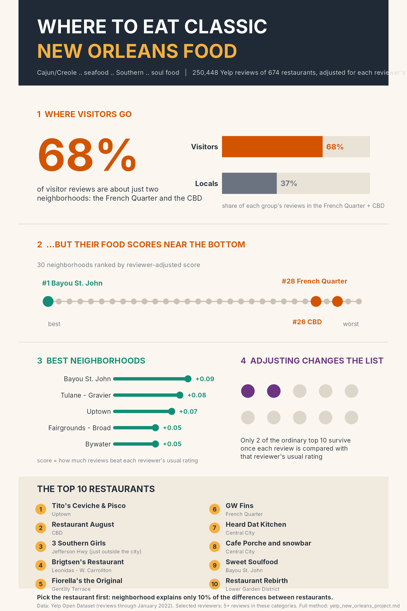

# Where to Find the Best Classic New Orleans Food

**Research question:** Where can a visitor find the best classic New Orleans cooking (Cajun/Creole, seafood, Southern and soul food), and which part of the city is best for finding it?

**[Open the full report: yelp_new_orleans_project.md](yelp_new_orleans_project.md)**

## Executive summary

This project uses the full Yelp Open Dataset (250,448 reviews of 674 classic New Orleans restaurants, through January 2022) to find the best places for Cajun/Creole, seafood, Southern and soul food. Ratings were adjusted for each reviewer's habits, comparing ordinary averages from all reviewers with normalized scores from 7,126 reviewers who wrote at least 5 reviews in this category. The best neighborhood for this food is **Bayou St. John**, while the two neighborhoods with the most of these restaurants, French Quarter (Vieux Carre) and Central Business District, rank #28 and #26 of 30.

## The answer: top 10 restaurants

1. **Tito's Ceviche & Pisco** (Uptown)
2. **Restaurant August** (Central Business District)
3. **3 Southern Girls** (Outside Orleans Parish)
4. **Brigtsen's Restaurant** (Leonidas - West Carrollton)
5. **Fiorella's the Original** (Gentilly Terrace)
6. **GW Fins** (French Quarter (Vieux Carre))
7. **Heard Dat Kitchen** (Central City - Magnolia)
8. **Cafe Porche and snowbar** (Central City - Magnolia)
9. **Sweet Soulfood** (Bayou St. John)
10. **Restaurant Rebirth** (St. Thomas Area - Lower Garden District)

## Main findings

1. **The busiest neighborhoods are not the best ones.** Visitors write 68% of their reviews in French Quarter (Vieux Carre) and Central Business District, and those neighborhoods rank #28 and #26 of 30 after reviewer adjustment.
2. **Adjusting for reviewer habits changes the list.** Only 2 of the ordinary top 10 (by average stars) stay in the top 10 once each review is compared with that reviewer's usual rating.
3. **The restaurant matters more than the neighborhood.** Neighborhood explains only 10% of the differences between restaurants, so the answer is a list of restaurants, not just an area.

## Data, categories and geography

- **Data:** Yelp Open Dataset business, review and user files, filtered to New Orleans, Louisiana.
- **Restaurant definition:** Yelp city "New Orleans" and state "LA", with "Restaurants" in the categories; checked against the official Census city boundary with a spatial join.
- **Categories:** Cajun/Creole, seafood, Southern and soul food (at least one required); 674 restaurants qualify. Co-occurrence analysis shows these categories appear together 2 to 4 times more often than chance.
- **Geography:** City of New Orleans Neighborhood Statistical Areas, chosen over ZIP codes and census tracts (comparison in Step 6 of the report).
- **Limitations:** data ends in January 2022; Yelp reviewers are self-selected; the locals/visitors label is a proxy. See the report's Limitations section.

## At a Glance

## Files

| File | What it is |
|---|---|
| [`project2_load_yelp.R`](project2_load_yelp.R) | Unzips the Yelp data, streams the large JSON files in chunks, keeps New Orleans rows, and saves them as `.rds` |
| [`yelp_new_orleans_project.qmd`](yelp_new_orleans_project.qmd) | Quarto source for the whole analysis (it also writes this README) |
| [`yelp_new_orleans_project.md`](yelp_new_orleans_project.md) | Rendered report, viewable on GitHub |
| [`figures/`](figures/) | Saved maps and charts |

## Reproducing the project

1. Download **Download JSON** (`Yelp-JSON.zip`, 4.35 GB) from the [Yelp Open Dataset page](https://business.yelp.com/data/resources/open-dataset/) and put it in `data/raw/`.
2. Run `project2_load_yelp.R`. This creates the filtered `.rds` files in `data/`. It needs about 13 GB of free disk space and takes roughly 20 to 30 minutes.
3. Open `yelp_new_orleans_project.qmd` in RStudio and click **Render**.

## Why the raw data is not in this repository

The raw Yelp files are about 8.65 GB, and GitHub rejects files over 100 MB. The `data/` folder is listed in `.gitignore`, so the raw and filtered data stay on the local computer. The code in this repository recreates them.

## AI use

I used Claude as a coding assistant throughout this project, mostly for technical steps (importing, saving, file management, figures) rather than for deciding what the analysis should conclude. I checked every result against my own rendered output.

**1. Saving the filtered data as RDS files and estimating run time**

- I asked Claude how to save the filtered New Orleans data as `.rds` files so I wouldn't have to re-import the huge JSON files every time, and how long the full import would take on my laptop.
- I followed up with questions about how much disk space the extraction needed and whether I could delete the raw files afterward. This shaped my workflow: run the import once (about 20–30 minutes), save compressed `.rds` files, and start every later step from those files, which load in seconds.

**2. Creating the figures**

- I asked Claude to help build the maps and charts with `ggplot2` and `sf`, including the neighborhood maps, the chart comparing raw ratings with reviewer-adjusted scores, and the final top 10 map.
- After rendering, I looked at each image and asked for fixes where something was hard to read. The changes included zooming the maps to where the restaurants are, using `ggrepel` so labels don't overlap, and giving the locals-vs-visitors chart equal axes so the comparison is fair. Each figure is also saved as a `.png` in `figures/` so it shows on GitHub.

**3. A result that looked wrong after rendering**

- I pasted my results table back into the chat. Claude noticed that every neighborhood had the same score (3.92) and a weight of 0.01, and explained that the method estimating neighborhood differences had pulled every neighborhood to the city average.
- It replaced that method with a fixed, documented rule and added an ANOVA to test whether neighborhood matters at all.

**4. Checking my work against the assignment**

- I asked whether the extra ideas fit the rubric, and then pasted the project instructions.
- Claude found that my Step 7 didn't follow the required method (reviewer baselines within my category group, a 5-review threshold, all vs. selected reviewers, top 10 map), and rebuilt it.

**What I learned:** pasting real output back into the chat worked much better than asking it to "make it better." Giving it the actual rubric mattered most.

(Also in [`ai_use.md`](ai_use.md).)
