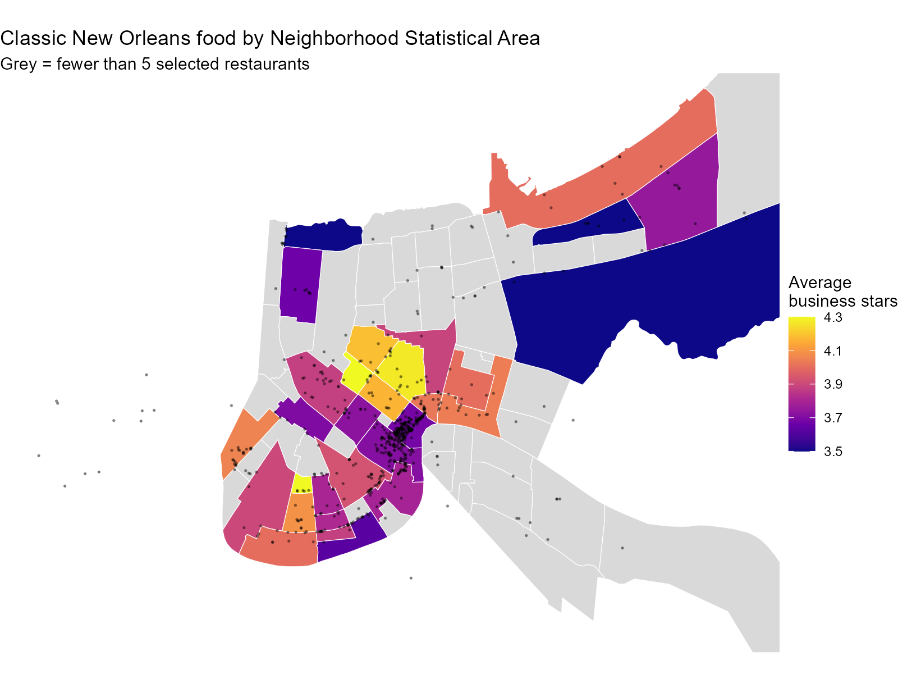

# Where to Find the Best Classic New Orleans Food

A data project using the Yelp Open Dataset to find where visitors can get the
best **Cajun/Creole, seafood, Southern, and soul food** restaurants in New
Orleans, and which neighborhoods are best for finding them.

## Progress report (Steps 1–6)

**[Open the analysis: yelp_new_orleans_project.md](yelp_new_orleans_project.md)**

It covers importing the large JSON files, choosing the restaurant categories
(with co-occurrence evidence), joining businesses to reviews, a spatial join
with the official New Orleans boundary, and a comparison of three geographic
systems (ZIP codes, census tracts, and Neighborhood Statistical Areas).

## Files

| File | What it is |
|---|---|
| [`project2_load_yelp.R`](project2_load_yelp.R) | Unzips the Yelp data, streams the large JSON files in chunks, keeps New Orleans rows, and saves them as `.rds` |
| [`yelp_new_orleans_project.qmd`](yelp_new_orleans_project.qmd) | Quarto source for the analysis |
| [`yelp_new_orleans_project.md`](yelp_new_orleans_project.md) | Rendered report (viewable on GitHub) |
| [`figures/`](figures/) | Saved maps and charts |

## Reproducing the project

1. Download **Download JSON** (`Yelp-JSON.zip`, 4.35 GB) from the
   [Yelp Open Dataset page](https://business.yelp.com/data/resources/open-dataset/)
   and put it in `data/raw/`.
2. Run `project2_load_yelp.R`. This creates the filtered `.rds` files in `data/`.
   It needs about 13 GB of free disk space and takes roughly 20–30 minutes.
3. Open `yelp_new_orleans_project.qmd` in RStudio and click **Render**.

## Why the raw data is not in this repository

The raw Yelp files are about 8.65 GB, and GitHub rejects files over 100 MB.
The `data/` folder is listed in `.gitignore`, so the raw and filtered data
stay on the local computer. The code in this repository recreates them.
