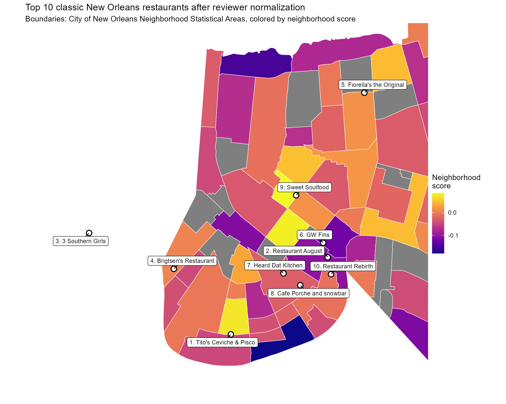
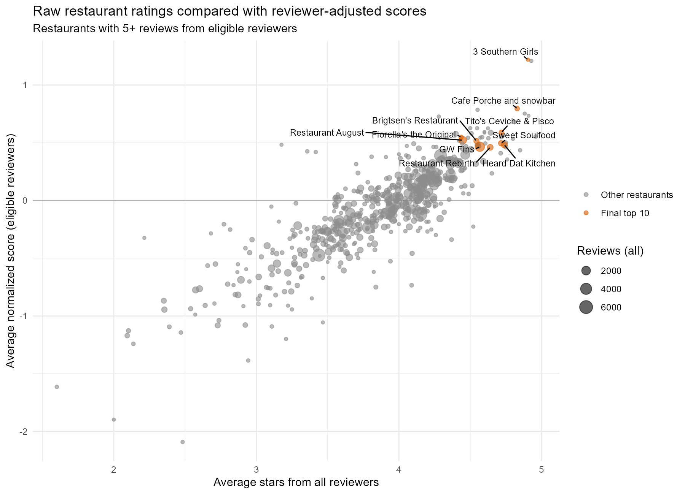
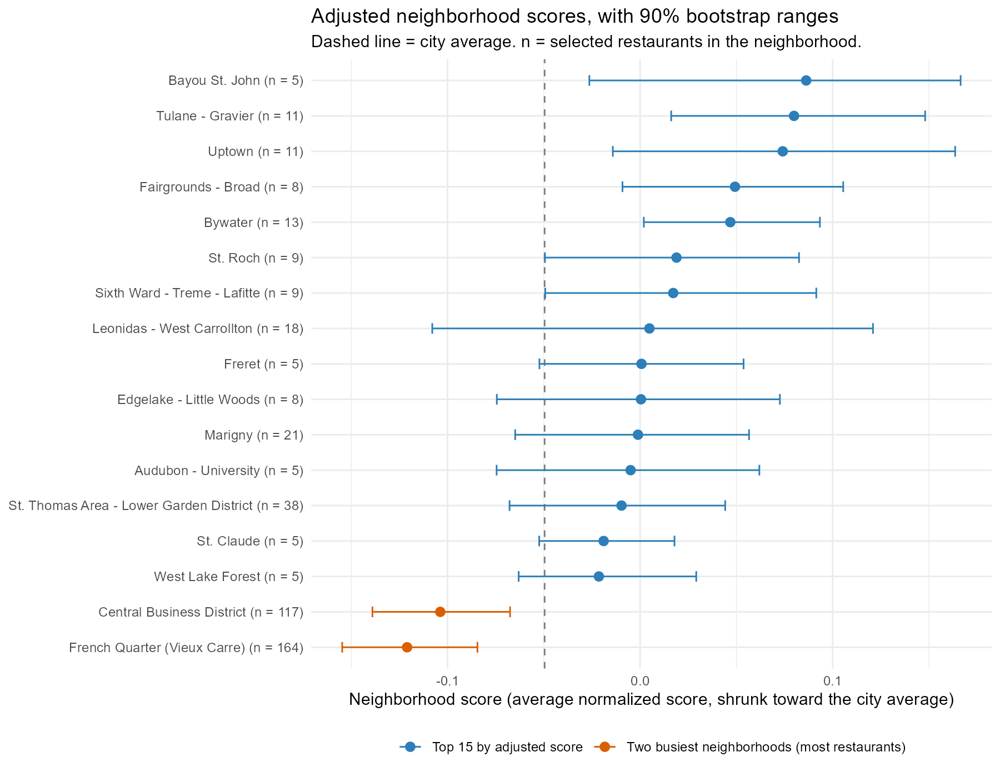
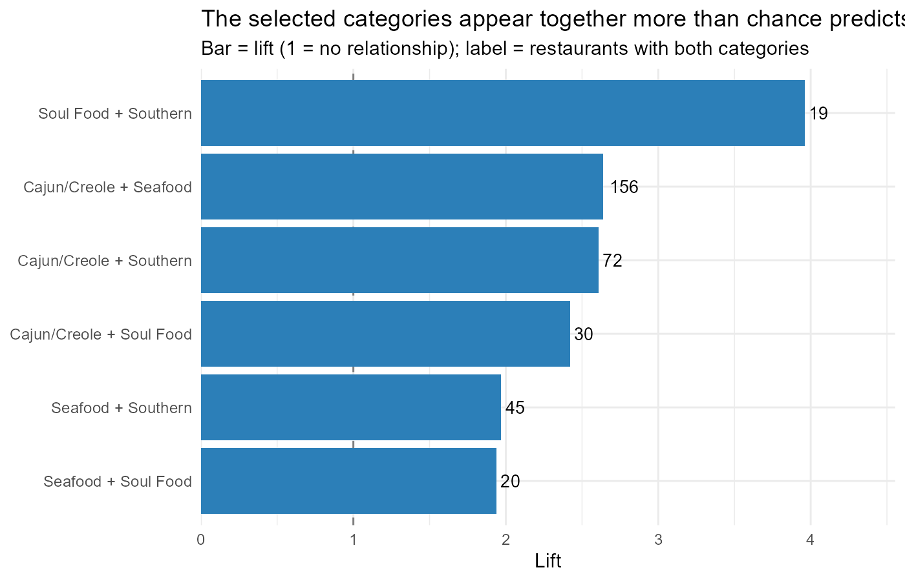

# Classic New Orleans Food on Yelp

**Working research question:** *Where can a visitor find the best
classic New Orleans cooking (Cajun/Creole, seafood, Southern, and soul
food), and which part of the city is best for finding it?*

This file covers Steps 1–7 of the project: importing the data, cleaning
it, choosing a category group, joining businesses to reviews, a spatial
join with official boundaries, choosing a geographic system, and a
comparison of ratings from all reviewers with normalized scores from
selected reviewers. **To jump to the answer, see the top 10 restaurants
and map in [Step 7.8](#the-answer-top-10-restaurants-and-where-they-are)
and the [Conclusion](#conclusion).**

> **How this file was made:** `yelp_new_orleans_project.qmd` was
> rendered to this Markdown file in RStudio, so every table and map
> below can be seen on GitHub without running any code.

```{r setup}
# Run once if needed:
# install.packages(c("tidyverse", "sf", "tigris", "scales", "knitr", "ggrepel"))
library(tidyverse)
library(sf)
library(tigris)
library(scales)
library(knitr)

options(tigris_use_cache = TRUE)
sf_use_s2(FALSE)   # planar point-in-polygon tests; fine at city scale
dir.create("figures", showWarnings = FALSE)
dir.create("data/boundaries", recursive = TRUE, showWarnings = FALSE)
```

## Step 1: Importing the large JSON files

The raw Yelp files are not stored in this repository. The import code is
in [`project2_load_yelp.R`](project2_load_yelp.R). It unzips the Yelp
download, reads each JSON file with `jsonlite::stream_in()`, keeps only
New Orleans rows, and saves them as `.rds` files in `data/`.

### Large-data management

- **Download:** The JSON download is a 4.35 GB zip file (8.65 GB once
  extracted). The first attempt to download it from inside R with
  `download.file()` failed partway through. A browser download worked,
  and the zip was then moved into `data/raw/`.
- **Disk space:** Extracting the files needs about 13 GB free while the
  import runs. After the filtered `.rds` files were saved and checked,
  the raw files in `data/raw/` could be deleted.
- **Memory:** The review file has about 7 million rows, and loading it
  all at once can crash R on a laptop. The script reads it in
  100,000-row chunks
  (`stream_in(..., pagesize = 100000, handler = ...)`) and keeps only
  reviews of New Orleans businesses from each chunk. The tip, check-in,
  and user files were read the same way.
- **Time:** The full import took roughly 20–30 minutes. After that,
  every analysis step starts from the small `.rds` files, which load in
  seconds.
- **GitHub:** `data/`, `*.rds`, `*.zip`, `*.tar` and `*.json` are listed
  in `.gitignore`, because GitHub rejects files over 100 MB and the raw
  data is far larger than that.

```{r load-data}
business <- readRDS("data/nola_business.rds")
reviews  <- readRDS("data/nola_reviews.rds")

tibble(
  table   = c("New Orleans businesses", "Reviews of those businesses"),
  rows    = c(nrow(business), nrow(reviews)),
  columns = c(ncol(business), ncol(reviews))
) |>
  kable(format.args = list(big.mark = ","))
```

## Step 2: Clean and filter to New Orleans restaurants

The import script already kept businesses whose Yelp `city` is "New
Orleans" (ignoring capitalization and extra spaces) and whose `state` is
"LA". Here a business counts as a **restaurant** if its comma-separated
`categories` field contains the label "Restaurants". Step 5 checks the
Yelp city label against the official Census boundary.

```{r restaurants}
nola_restaurants <- business |>
  filter(
    !is.na(categories),
    str_detect(categories, regex("\\bRestaurants\\b", ignore_case = TRUE))
  ) |>
  mutate(
    postal_code   = na_if(postal_code, ""),
    categories    = str_squish(categories),
    business_name = str_squish(name)
  ) |>
  distinct(business_id, .keep_all = TRUE) |>
  select(any_of(c(
    "business_id", "business_name", "address", "city", "state",
    "postal_code", "latitude", "longitude", "stars", "review_count",
    "is_open", "categories"
  )))

nola_restaurants |>
  summarise(
    businesses_in_new_orleans = nrow(business),
    restaurants               = n(),
    missing_latitude          = sum(is.na(latitude)),
    missing_longitude         = sum(is.na(longitude)),
    missing_postal_code       = sum(is.na(postal_code)),
    still_open                = sum(is_open == 1, na.rm = TRUE)
  ) |>
  kable(format.args = list(big.mark = ","))
```

## Step 3: Select related restaurant categories

### Category counts

Each restaurant can have many categories, so the `categories` field is
split into one row per business–category pair. The labels are converted
to lower case and stripped of extra spaces before counting. The generic
labels "restaurants" and "food" are removed because they are too general
to describe a cuisine (every restaurant here has the "restaurants" label
by definition).

```{r category-counts}
restaurant_categories <- nola_restaurants |>
  select(business_id, categories) |>
  separate_rows(categories, sep = ",") |>
  mutate(category = str_to_lower(str_squish(categories))) |>
  filter(category != "", !category %in% c("restaurants", "food")) |>
  distinct(business_id, category)

category_counts <- restaurant_categories |>
  count(category, name = "restaurants", sort = TRUE)

category_counts |>
  slice_head(n = 20) |>
  kable(caption = "20 most common restaurant categories in New Orleans")
```

### The selected category group

```{r selected-categories}
selected_categories <- c("cajun/creole", "seafood", "southern", "soul food")
```

These four categories cover **classic New Orleans cooking**: gumbo,
jambalaya and étouffée (Cajun/Creole), Gulf oysters, shrimp and crawfish
(seafood), and fried chicken, red beans and smothered greens (Southern
and soul food). They answer the question a visitor actually asks: *where
do I go for food I can only get done this well in New Orleans?* They
were chosen for that theme, not because they are the most common
categories.

**Inclusion rule:** a restaurant is included if it has **at least one**
of the four categories.

```{r selected-counts}
category_counts |>
  filter(category %in% selected_categories) |>
  kable(caption = "Restaurants in each selected category")

selected_ids <- restaurant_categories |>
  filter(category %in% selected_categories) |>
  distinct(business_id)

matches_per_restaurant <- restaurant_categories |>
  semi_join(selected_ids, by = "business_id") |>
  group_by(business_id) |>
  summarise(selected_matches = sum(category %in% selected_categories)) |>
  count(selected_matches, name = "restaurants")

matches_per_restaurant |>
  kable(caption = "How many of the four selected categories each included restaurant matches")
```

### Co-occurrence evidence

If the categories belong together, restaurants should carry them
**together** more often than chance would predict. `lift` compares the
observed overlap of each pair with the overlap expected if the
categories were unrelated (`lift = 1` means unrelated; `lift = 2` means
twice as common as expected).

```{r co-occurrence}
n_restaurants <- n_distinct(nola_restaurants$business_id)

selected_long <- restaurant_categories |>
  filter(category %in% selected_categories)

pair_counts <- selected_long |>
  inner_join(selected_long, by = "business_id",
             relationship = "many-to-many") |>
  filter(category.x < category.y) |>
  count(category.x, category.y, name = "restaurants_with_both") |>
  left_join(category_counts, by = c("category.x" = "category")) |>
  rename(n_x = restaurants) |>
  left_join(category_counts, by = c("category.y" = "category")) |>
  rename(n_y = restaurants) |>
  mutate(
    expected_if_unrelated = round(n_x * n_y / n_restaurants, 1),
    lift = round(restaurants_with_both / expected_if_unrelated, 2)
  ) |>
  arrange(desc(restaurants_with_both))

pair_counts |>
  select(category_1 = category.x, category_2 = category.y,
         restaurants_with_both, expected_if_unrelated, lift) |>
  kable(caption = "Category pairs within the selected group")
```

```{r co-occurrence-plot, fig.width = 7, fig.height = 4.5}
cooccur_plot <- pair_counts |>
  mutate(pair = paste(str_to_title(category.x), "+", str_to_title(category.y)),
         pair = fct_reorder(pair, lift)) |>
  ggplot(aes(x = lift, y = pair)) +
  geom_vline(xintercept = 1, linetype = "dashed", color = "grey50") +
  geom_col(fill = "#2c7fb8") +
  geom_text(aes(label = restaurants_with_both), hjust = -0.2, size = 3.5) +
  scale_x_continuous(expand = expansion(mult = c(0, 0.15))) +
  labs(
    title = "The selected categories appear together more than chance predicts",
    subtitle = "Bar = lift (1 = no relationship); label = restaurants with both categories",
    x = "Lift", y = NULL
  ) +
  theme_minimal()

cooccur_plot
ggsave("figures/category_cooccurrence.png", cooccur_plot,
       width = 7, height = 4.5, dpi = 200, bg = "white")
```

```{r selected-restaurants}
selected_restaurants <- nola_restaurants |>
  semi_join(selected_ids, by = "business_id")
```

**Result:** `r comma(nrow(selected_restaurants))` of the
`r comma(n_restaurants)` New Orleans restaurants
(`r percent(nrow(selected_restaurants) / n_restaurants, 0.1)`) meet the
inclusion rule.

## Step 4: Join businesses to reviews

The reviews are filtered to the selected restaurants **before** any
further work, so reviews of unrelated businesses are not carried through
the analysis. The review text is dropped here because Steps 4–7 don't
use it, which saves a lot of memory. The two tables are connected by
`business_id` (one business, many reviews).

```{r join-reviews}
selected_reviews <- reviews |>
  semi_join(selected_restaurants, by = "business_id") |>
  select(any_of(c("review_id", "business_id", "user_id", "stars", "date",
                  "useful", "funny", "cool")))

rm(reviews); invisible(gc())   # the full review table is no longer needed

review_summary <- selected_reviews |>
  group_by(business_id) |>
  summarise(
    n_reviews         = n(),
    mean_review_stars = mean(stars, na.rm = TRUE),
    .groups = "drop"
  )

selected_restaurants <- selected_restaurants |>
  left_join(review_summary, by = "business_id") |>
  mutate(n_reviews = replace_na(n_reviews, 0L))

tibble(
  check = c(
    "Reviews of selected restaurants",
    "Selected restaurants with at least 1 review",
    "Selected restaurants with no reviews in the file",
    "Reviews whose business_id has no match (should be 0)",
    "Correlation: Yelp business stars vs. mean review stars"
  ),
  value = c(
    comma(nrow(selected_reviews)),
    comma(sum(selected_restaurants$n_reviews > 0)),
    comma(sum(selected_restaurants$n_reviews == 0)),
    comma(nrow(anti_join(selected_reviews, selected_restaurants,
                         by = "business_id"))),
    round(cor(selected_restaurants$stars,
              selected_restaurants$mean_review_stars,
              use = "complete.obs"), 3)
  )
) |>
  kable()
```

## Step 5: Spatial join with the official New Orleans boundary

Each restaurant's latitude and longitude becomes a point. Each point is
matched to the 2024 Census TIGER/Line **place** polygon that contains
it. This gives a second geographic label, made independently of the Yelp
`city` text.

```{r census-places}
la_places <- tryCatch(
  places(state = "LA", cb = TRUE, year = 2024),
  error = function(e) places(state = "LA", cb = TRUE, year = 2023)
) |>
  st_transform(4326) |>
  st_make_valid()

restaurant_points <- selected_restaurants |>
  filter(!is.na(longitude), !is.na(latitude)) |>
  st_as_sf(coords = c("longitude", "latitude"), crs = 4326, remove = FALSE)

restaurants_with_place <- restaurant_points |>
  st_join(la_places |> select(place_geoid = GEOID, place_name = NAME),
          join = st_within, left = TRUE) |>
  distinct(business_id, .keep_all = TRUE)

restaurants_with_place |>
  st_drop_geometry() |>
  mutate(place_name = replace_na(place_name,
                                 "(not inside any Census place)")) |>
  count(yelp_city = city, census_place = place_name, sort = TRUE,
        name = "restaurants") |>
  kable(caption = "Yelp city label vs. the Census place the point falls in")
```

```{r place-mismatch-note, results = "asis"}
n_inside  <- sum(restaurants_with_place$place_name == "New Orleans",
                 na.rm = TRUE)
n_outside <- nrow(restaurants_with_place) - n_inside
cat(sprintf(
  "**%s of %s** selected restaurants (%s) fall inside the official New Orleans boundary. The other **%s** have a Yelp city of \"New Orleans\" but coordinates outside it. The table above shows where they fall instead. Businesses in nearby Jefferson Parish suburbs often use \"New Orleans\" as their mailing-address city, and a few points may simply be geocoded slightly off. They were not deleted. They are kept in the geographic comparison below, where they show up as *unmatched* for any boundary system that covers only Orleans Parish.\n",
  comma(n_inside), comma(nrow(restaurants_with_place)),
  percent(n_inside / nrow(restaurants_with_place), 0.1), comma(n_outside)
))
```

```{r place-map, fig.width = 8, fig.height = 6}
new_orleans_boundary <- la_places |> filter(NAME == "New Orleans")

# Zoom to where the restaurants are (the city boundary includes large
# areas of marsh and water in New Orleans East).
pts_xy <- st_coordinates(restaurant_points)
view_x <- quantile(pts_xy[, 1], c(0.01, 0.99)) + c(-0.03, 0.03)
view_y <- quantile(pts_xy[, 2], c(0.01, 0.99)) + c(-0.03, 0.03)

place_map <- ggplot() +
  geom_sf(data = new_orleans_boundary, fill = "grey95", color = "grey35") +
  geom_sf(data = restaurants_with_place,
          aes(color = stars,
              shape = if_else(place_name %in% "New Orleans",
                              "Inside city boundary", "Outside city boundary")),
          alpha = 0.7, size = 1.4) +
  scale_color_viridis_c(option = "C", limits = c(1, 5)) +
  scale_shape_manual(values = c(16, 4)) +
  coord_sf(xlim = view_x, ylim = view_y) +
  labs(
    title = "Classic New Orleans food restaurants on Yelp",
    subtitle = "Grey area = official New Orleans city boundary (Census TIGER/Line)",
    color = "Business\nstars", shape = NULL
  ) +
  theme_minimal()

place_map
ggsave("figures/restaurants_city_boundary.png", place_map,
       width = 8, height = 6, dpi = 200, bg = "white")
```

## Step 6: Choose and defend a geographic area

Three geographic systems were tested:

| System | Source | Notes |
|------------------------|------------------------|------------------------|
| ZIP Code Tabulation Areas (ZCTAs) | Census 2020, via `tigris` | Postal-style areas that people recognize, but not neighborhoods |
| Census tracts | Census 2023, via `tigris` (Orleans, Jefferson, St. Bernard parishes) | Small statistical areas designed for population data |
| Neighborhood Statistical Areas (NSAs) | City of New Orleans GIS (`LUP_LAB` = neighborhood name) | 72 official neighborhoods with names residents use; Orleans Parish only |

```{r boundaries}
# ---- ZCTAs (ZIP codes starting 700/701 cover the metro area) ----------
zcta_raw <- tryCatch(
  zctas(cb = TRUE, year = 2020, starts_with = c("700", "701")),
  error = function(e) zctas(cb = FALSE, year = 2020,
                            starts_with = c("700", "701"))
)
zcta_id <- intersect(c("ZCTA5CE20", "GEOID20", "ZCTA5CE10", "GEOID10",
                       "GEOID"), names(zcta_raw))[1]
zcta_areas <- zcta_raw |>
  st_transform(4326) |>
  st_make_valid() |>
  mutate(area_id = as.character(.data[[zcta_id]]),
         area_name = paste("ZIP", area_id)) |>
  select(area_id, area_name)

# ---- Census tracts ------------------------------------------------------
tract_areas <- tracts(state = "LA",
                      county = c("Orleans", "Jefferson", "St. Bernard"),
                      cb = TRUE, year = 2023) |>
  st_transform(4326) |>
  st_make_valid() |>
  mutate(area_id = GEOID, area_name = paste("Tract", GEOID)) |>
  select(area_id, area_name)

# ---- Neighborhood Statistical Areas (City of New Orleans) --------------
# The file is downloaded once and saved in data/boundaries/. If every URL
# fails, download the GeoJSON by hand from
# https://catalog.data.gov/dataset/neighborhood-statistical-area
# and save it as data/boundaries/nsa.geojson.
nsa_file <- "data/boundaries/nsa.geojson"
nsa_urls <- c(
  "https://gis.nola.gov/arcgis/rest/services/apps/BoundariesMayorysViewer/MapServer/3/query?where=1%3D1&outFields=*&outSR=4326&f=geojson",
  "https://data.nola.gov/api/v3/views/exvn-jeh2/query.geojson?accessType=DOWNLOAD",
  "https://data.nola.gov/resource/exvn-jeh2.geojson?$limit=5000"
)
if (!file.exists(nsa_file)) {
  for (u in nsa_urls) {
    ok <- tryCatch({
      download.file(u, nsa_file, mode = "wb", quiet = TRUE)
      nrow(st_read(nsa_file, quiet = TRUE)) > 0
    }, error = function(e) FALSE)
    if (isTRUE(ok)) break
    if (file.exists(nsa_file)) file.remove(nsa_file)
  }
}

nsa_areas <- NULL
if (file.exists(nsa_file)) {
  nsa_raw <- st_read(nsa_file, quiet = TRUE)
  nsa_name <- intersect(c("LUP_LAB", "lup_lab", "GNOCDC_LAB", "gnocdc_lab",
                          "NAME", "name", "neighborhood"), names(nsa_raw))[1]
  nsa_areas <- nsa_raw |>
    st_transform(4326) |>
    st_make_valid() |>
    mutate(area_name = str_to_title(str_squish(.data[[nsa_name]])),
           area_id = area_name) |>
    group_by(area_id, area_name) |>          # merge any multi-part rows
    summarise(.groups = "drop")
}

systems <- list(
  "ZIP code (ZCTA)" = zcta_areas,
  "Census tract"    = tract_areas
)
if (!is.null(nsa_areas)) {
  systems[["Neighborhood Statistical Area"]] <- nsa_areas
}
```

```{r spatial-joins}
min_restaurants <- 5   # areas below this are too small to compare reliably

assign_areas <- function(areas) {
  restaurant_points |>
    st_join(areas, join = st_within, left = TRUE) |>
    st_drop_geometry() |>
    distinct(business_id, .keep_all = TRUE)
}

summarise_areas <- function(assigned) {
  assigned |>
    filter(!is.na(area_id)) |>
    group_by(area_id, area_name) |>
    summarise(
      restaurants            = n(),
      avg_business_stars     = mean(stars, na.rm = TRUE),
      median_business_stars  = median(stars, na.rm = TRUE),
      pct_4_stars_plus       = mean(stars >= 4, na.rm = TRUE),
      total_reviews          = sum(n_reviews),
      avg_review_stars       = sum(mean_review_stars * n_reviews, na.rm = TRUE) /
                               sum(n_reviews),
      .groups = "drop"
    ) |>
    arrange(desc(restaurants))
}

assigned  <- map(systems, assign_areas)
summaries <- map(assigned, summarise_areas)
```

### Comparison of geographic systems

```{r comparison-table}
comparison <- imap_dfr(summaries, function(s, sys) {
  big <- s |> filter(restaurants >= min_restaurants)
  tibble(
    `Geographic system`                = sys,
    `Areas with >=1 restaurant`         = nrow(s),
    `Areas with >=5 restaurants`        = nrow(big),
    `Restaurants assigned`             = sum(!is.na(assigned[[sys]]$area_id)),
    `Unmatched restaurants`            = sum(is.na(assigned[[sys]]$area_id)),
    `Smallest area count`              = min(s$restaurants),
    `Median area count`                = median(s$restaurants),
    `Largest area count`               = max(s$restaurants),
    `% of restaurants in areas with >=5` = percent(sum(big$restaurants) /
                                                   sum(s$restaurants), 1),
    `Range of avg stars (areas with >=5)` = sprintf("%.2f to %.2f",
                                         min(big$avg_business_stars),
                                         max(big$avg_business_stars))
  )
})

comparison |> kable()
```

### Small areas produce unstable averages

Each point below is one area. In areas with only a few restaurants, a
single very good or very bad restaurant pushes the average to an
extreme. That is why the smallest geography is not automatically the
most informative one.

```{r funnel-plot, fig.width = 10, fig.height = 4}
funnel_data <- imap_dfr(summaries, ~ mutate(.x, system = .y))

funnel_plot <- ggplot(funnel_data,
                      aes(x = restaurants, y = avg_business_stars)) +
  geom_vline(xintercept = min_restaurants, linetype = "dashed",
             color = "firebrick") +
  geom_point(alpha = 0.6, color = "#2c7fb8") +
  scale_x_log10() +
  facet_wrap(~ system) +
  labs(
    title = "Average stars become unstable in areas with few restaurants",
    subtitle = sprintf("Dashed line = %d restaurants (minimum used for comparing areas)",
                       min_restaurants),
    x = "Selected restaurants in the area (log scale)",
    y = "Average business stars"
  ) +
  theme_minimal()

funnel_plot
ggsave("figures/area_size_vs_stars.png", funnel_plot,
       width = 10, height = 4, dpi = 200, bg = "white")
```

### Maps of each geographic system

Areas with fewer than `r min_restaurants` selected restaurants are grey.
Black dots are the individual restaurants.

```{r area-maps, fig.width = 8, fig.height = 6}
area_map <- function(sys) {
  map_data <- systems[[sys]] |>
    left_join(summaries[[sys]], by = c("area_id", "area_name")) |>
    mutate(avg_plot = if_else(restaurants >= min_restaurants,
                              avg_business_stars, NA_real_))
  ggplot(map_data) +
    geom_sf(aes(fill = avg_plot), color = "white", linewidth = 0.2) +
    geom_sf(data = restaurant_points, size = 0.3, alpha = 0.35) +
    scale_fill_viridis_c(option = "C", na.value = "grey85",
                         name = "Average\nbusiness stars") +
    coord_sf(xlim = view_x, ylim = view_y) +
    labs(title = paste("Classic New Orleans food by", sys),
         subtitle = sprintf("Grey = fewer than %d selected restaurants",
                            min_restaurants)) +
    theme_void()
}

for (sys in names(systems)) {
  p <- area_map(sys)
  print(p)
  ggsave(sprintf("figures/map_%s.png",
                 str_remove(str_replace_all(str_to_lower(sys), "[^a-z]+", "_"), "_$")),
         p, width = 8, height = 6, dpi = 200, bg = "white")
}
```

### Decision

```{r chosen-system}
chosen_system <- if ("Neighborhood Statistical Area" %in% names(systems)) {
  "Neighborhood Statistical Area"
} else {
  "ZIP code (ZCTA)"
}
chosen_row <- comparison |> filter(`Geographic system` == chosen_system)
zcta_row   <- comparison |> filter(`Geographic system` == "ZIP code (ZCTA)")
tract_row  <- comparison |> filter(`Geographic system` == "Census tract")
```

```{r decision-text, results = "asis"}
if (chosen_system == "Neighborhood Statistical Area") {
  cat(sprintf(
"**Selected system: Neighborhood Statistical Areas (NSAs).**

1. **It matches the question.** The question is *where a visitor should go*. People plan trips by neighborhood (the French Quarter, the Marigny, the Garden District, Uptown), not by ZIP code or census tract. NSAs are the City of New Orleans' official neighborhood boundaries, so every result has a name a general reader recognizes.
2. **Enough restaurants for fair comparisons.** %s neighborhoods have at least %d selected restaurants, covering %s of the restaurants that were matched (the project requires at least 7 areas).
3. **Census tracts are too small.** Tracts split the city into %s areas with restaurants, but the median tract has only %s selected restaurants. Only %s tracts reach %d restaurants, so tract averages are mostly noise from one or two businesses (see the plot above). Tract names (numbers) also mean nothing to a visitor.
4. **ZIP codes are too coarse and cut across neighborhoods.** ZCTAs give stable counts (%s areas with >=%d restaurants), but a single ZIP code mixes very different places. For example, the French Quarter is split between ZIP codes it shares with Treme, the Marigny, and the Central Business District (Step 7.7 shows the split). A \"best ZIP code\" answer hides the neighborhood a visitor would actually walk to.
5. **Trade-off: unmatched points.** NSAs cover Orleans Parish only, so %s restaurants with a Yelp city of \"New Orleans\" but suburban coordinates (Step 5) are unmatched, compared with %s for ZIP codes. Because the question is about New Orleans itself, dropping them from the area comparison is reasonable. The ZIP-code results are kept as a robustness check, and the final report will note whether the top areas agree.
6. **Documented definitions.** NSA names and boundaries are published by the City of New Orleans, and the Census geographies are documented by TIGER/Line.

**What NSAs hide:** a neighborhood average can mix an excellent block with a weak one, and large neighborhoods with few restaurants (e.g., in New Orleans East) are grey on the map rather than ranked. Areas below %d restaurants are reported but not ranked.\n",
    chosen_row$`Areas with >=5 restaurants`, min_restaurants,
    chosen_row$`% of restaurants in areas with >=5`,
    tract_row$`Areas with >=1 restaurant`, tract_row$`Median area count`,
    tract_row$`Areas with >=5 restaurants`, min_restaurants,
    zcta_row$`Areas with >=5 restaurants`, min_restaurants,
    comma(chosen_row$`Unmatched restaurants`),
    comma(zcta_row$`Unmatched restaurants`),
    min_restaurants
  ))
} else {
  cat(sprintf(
"**Selected system: ZIP Code Tabulation Areas.** (The City of New Orleans neighborhood file could not be downloaded, so the comparison is between ZCTAs and census tracts.)

ZCTAs are familiar to a general audience, and %s of them have at least %d selected restaurants, which gives stable averages. Census tracts are too small: the median tract has only %s selected restaurants, and only %s tracts reach %d, so tract averages mostly reflect one or two businesses. Limitation: ZIP codes are not neighborhoods, and one ZIP code can mix very different areas.\n",
    zcta_row$`Areas with >=5 restaurants`, min_restaurants,
    tract_row$`Median area count`, tract_row$`Areas with >=5 restaurants`,
    min_restaurants
  ))
}
```

### Preliminary results for the chosen system

These rankings use ordinary Yelp business stars. Step 7 will check
whether they change once ratings are adjusted for each reviewer's
habits.

```{r chosen-table}
summaries[[chosen_system]] |>
  filter(restaurants >= min_restaurants) |>
  arrange(desc(avg_business_stars)) |>
  slice_head(n = 10) |>
  transmute(
    Area                    = area_name,
    Restaurants             = restaurants,
    `Avg business stars`    = round(avg_business_stars, 2),
    `Median stars`          = median_business_stars,
    `% rated 4+`            = percent(pct_4_stars_plus, 1),
    `Total reviews`         = comma(total_reviews),
    `Avg review stars`      = round(avg_review_stars, 2)
  ) |>
  kable(caption = sprintf("Top 10 %ss for classic New Orleans food (areas with >=%d restaurants)",
                          chosen_system, min_restaurants))
```

```{r chosen-bar, fig.width = 8, fig.height = 6}
bar_data <- summaries[[chosen_system]] |>
  filter(restaurants >= min_restaurants) |>
  arrange(desc(avg_business_stars)) |>
  slice_head(n = 15) |>
  mutate(area_name = fct_reorder(area_name, avg_business_stars))

chosen_bar <- ggplot(bar_data, aes(x = avg_business_stars, y = area_name)) +
  geom_col(fill = "#2c7fb8") +
  geom_text(aes(label = paste0("n = ", restaurants)),
            hjust = 1.1, color = "white", size = 3.2) +
  coord_cartesian(xlim = c(1, 5)) +
  labs(
    title = sprintf("Highest-rated areas (%s)", chosen_system),
    subtitle = sprintf("Classic New Orleans food; areas with >=%d restaurants; n = restaurants",
                       min_restaurants),
    x = "Average business stars", y = NULL
  ) +
  theme_minimal()

chosen_bar
ggsave("figures/top_areas_bar.png", chosen_bar,
       width = 8, height = 6, dpi = 200, bg = "white")
```

```{r save-outputs}
# Save the joined data for Step 7 (stays local; data/ is in .gitignore)
saveRDS(
  list(selected_restaurants = selected_restaurants,
       selected_reviews     = selected_reviews,
       assigned             = assigned,
       chosen_system        = chosen_system),
  "data/steps_1_6_outputs.rds"
)
```

## Step 7: All reviewers vs. selected reviewers

Step 6 ranked neighborhoods by ordinary Yelp stars. Those stars have two
problems:

1.  **Reviewers grade on different curves.** Some reviewers give almost
    everything 5 stars, and others rarely go above 3. A 4-star review
    from a tough grader means more than a 4-star review from an easy
    one.
2.  **Small samples swing to extremes.** Step 6 showed that areas with
    only a few restaurants get extreme averages, and the top of the Step
    6 ranking is made up of exactly those small areas.

Step 7 compares ordinary averages from **all reviewers** with
**normalized scores from selected reviewers** who have enough activity
to measure their habits, and handles small samples explicitly. It then
tests whether the new ranking holds up in three ways: by resampling, by
splitting reviewers into locals and visitors, and by switching from
neighborhoods to ZIP codes.

### 7.1 What the data covers

```{r data-window}
# The city's official name for the French Quarter is "Vieux Carre".
# Use the name visitors know, everywhere it appears from here on.
fq_name <- function(x) if_else(x == "Vieux Carre", "French Quarter (Vieux Carre)", x)
systems[[chosen_system]]   <- systems[[chosen_system]]   |> mutate(area_name = fq_name(area_name))
assigned[[chosen_system]]  <- assigned[[chosen_system]]  |> mutate(area_name = fq_name(area_name))
summaries[[chosen_system]] <- summaries[[chosen_system]] |> mutate(area_name = fq_name(area_name))

users <- readRDS("data/nola_users.rds") |>
  distinct(user_id, .keep_all = TRUE)

# Every New Orleans review (not only the selected restaurants). Used in 7.6
# to count how many of each reviewer's reviews are in New Orleans.
user_nola_counts <- readRDS("data/nola_reviews.rds") |>
  count(user_id, name = "nola_reviews")
invisible(gc())

review_dates <- as.Date(substr(as.character(selected_reviews$date), 1, 10))
open_ids     <- selected_restaurants$business_id[selected_restaurants$is_open == 1]

tibble(
  check = c("Earliest review", "Latest review",
            "Selected restaurants still open at the snapshot",
            "Reviews of restaurants still open"),
  value = c(format(min(review_dates, na.rm = TRUE), "%B %Y"),
            format(max(review_dates, na.rm = TRUE), "%B %Y"),
            sprintf("%s of %s (%s)", comma(length(open_ids)),
                    comma(nrow(selected_restaurants)),
                    percent(length(open_ids) / nrow(selected_restaurants), 1)),
            percent(mean(selected_reviews$business_id %in% open_ids), 1))
) |>
  kable()
```

The Yelp Open Dataset is a snapshot, so these results describe New
Orleans up to `r format(max(review_dates, na.rm = TRUE), "%B %Y")`, not
today. Closed restaurants are **kept** in the neighborhood scores,
because they still tell us what a neighborhood's food was like over the
period. They are **removed** from the visitor recommendations in 7.8,
because nobody can eat at a closed restaurant.

### 7.2 All reviewers: ordinary Yelp averages

The first analysis uses **every review** of the selected restaurants and
computes ordinary averages. Restaurants with only a handful of reviews
can post perfect averages by luck, so the table below lists only
restaurants with at least 20 reviews.

```{r all-reviewers}
category_reviews <- selected_reviews |>
  mutate(review_date = as.Date(substr(as.character(date), 1, 10)),
         review_year = as.integer(format(review_date, "%Y")))

all_reviewer_summary <- category_reviews |>
  group_by(business_id) |>
  summarise(
    number_of_reviews_all_reviewers = n(),
    average_stars_all_reviewers     = mean(stars, na.rm = TRUE),
    median_stars_all_reviewers      = median(stars, na.rm = TRUE),
    .groups = "drop"
  )

raw_top10 <- all_reviewer_summary |>
  filter(number_of_reviews_all_reviewers >= 20) |>
  left_join(selected_restaurants |> select(business_id, business_name),
            by = "business_id") |>
  slice_max(average_stars_all_reviewers, n = 10, with_ties = FALSE)

raw_top10 |>
  transmute(Restaurant       = business_name,
            Reviews          = comma(number_of_reviews_all_reviewers),
            `Average stars`  = round(average_stars_all_reviewers, 2),
            `Median stars`   = median_stars_all_reviewers) |>
  kable(caption = "Top 10 by ordinary average stars, all reviewers (restaurants with 20+ reviews)")
```

### 7.3 Selected reviewers and normalized scores

**Who counts as a selected reviewer?** A reviewer's usual scoring habit
can only be measured if they have written several reviews. Reviews are
counted **within the selected category group** (Cajun/Creole, seafood,
Southern and soul food), and a reviewer is **eligible** with at least 5
such reviews.

**Normalized score.** Each eligible reviewer gets a **baseline**: their
mean star rating across their reviews in the category group. Each review
is then scored as *stars minus that reviewer's baseline*. A reviewer who
averages 3.0 and gives a restaurant 4 stars scores **+1.0**; a reviewer
who averages 4.8 and gives 4 stars scores **−0.8**. The normalized score
is **not a new Yelp rating**. It measures whether a review was higher or
lower than that reviewer's usual rating.

```{r reviewer-activity, results = "asis"}
reviewer_baselines <- category_reviews |>
  group_by(user_id) |>
  summarise(
    reviewer_mean         = mean(stars, na.rm = TRUE),
    reviewer_median       = median(stars, na.rm = TRUE),
    reviewer_review_count = n(),
    .groups = "drop"
  )

min_reviewer_reviews <- 5

category_reviews_adjusted <- category_reviews |>
  left_join(reviewer_baselines, by = "user_id") |>
  mutate(normalized_mean_score   = stars - reviewer_mean,
         normalized_median_score = stars - reviewer_median)

eligible_reviewers <- reviewer_baselines |>
  filter(reviewer_review_count >= min_reviewer_reviews)
eligible_adjusted_reviews <- category_reviews_adjusted |>
  semi_join(eligible_reviewers, by = "user_id")

cat(sprintf(
"Of the %s reviewers who reviewed these restaurants, **%s (%s) have at least %d reviews** in the category group. They wrote **%s of the %s reviews (%s)**. Most Yelp reviewers write only one or two reviews of this kind of restaurant, so the selected group is a small, highly active minority.\n",
  comma(nrow(reviewer_baselines)), comma(nrow(eligible_reviewers)),
  percent(nrow(eligible_reviewers) / nrow(reviewer_baselines), 0.1),
  min_reviewer_reviews,
  comma(nrow(eligible_adjusted_reviews)), comma(nrow(category_reviews)),
  percent(nrow(eligible_adjusted_reviews) / nrow(category_reviews), 1)
))
```

**Mean or median baseline?** Both were computed. Stars are whole numbers
from 1 to 5, so a reviewer's *median* is usually a whole number too, and
many reviews land exactly on it.

```{r mean-vs-median, results = "asis"}
mm <- eligible_adjusted_reviews |>
  summarise(zero_mean   = mean(abs(normalized_mean_score) < 1e-9),
            zero_median = mean(normalized_median_score == 0))

mm_rest <- eligible_adjusted_reviews |>
  group_by(business_id) |>
  summarise(n = n(), m_mean = mean(normalized_mean_score),
            m_median = mean(normalized_median_score), .groups = "drop") |>
  filter(n >= 5)

cat(sprintf(
"With the median baseline, **%s of reviews score exactly 0**, which throws away the difference between a reviewer who usually gives 4.6 stars and one who usually gives 4.0. With the mean baseline, %s score exactly 0. The two versions rank restaurants similarly (Spearman correlation %.2f across restaurants with 5+ eligible reviews), so the choice does not drive the results. **The mean-based score is used as the primary normalized score** because it keeps more information.\n",
  percent(mm$zero_median, 1), percent(mm$zero_mean, 1),
  cor(mm_rest$m_mean, mm_rest$m_median, method = "spearman")
))
```

```{r grader-table}
eligible_adjusted_reviews |>
  mutate(grader = case_when(
    reviewer_mean < 3.5  ~ "1. Tough grader (mean below 3.5)",
    reviewer_mean <= 4.5 ~ "2. Middle (3.5 to 4.5)",
    TRUE                 ~ "3. Easy grader (mean above 4.5)"
  )) |>
  group_by(grader) |>
  summarise(
    reviewers          = n_distinct(user_id),
    reviews            = n(),
    `avg stars given`  = round(mean(stars), 2),
    .groups = "drop"
  ) |>
  mutate(`share of eligible reviews` = percent(reviews / sum(reviews), 1),
         reviewers = comma(reviewers), reviews = comma(reviews)) |>
  kable(caption = "Eligible reviewers by grading habit: the same star means different things")
```

**Restaurant scores.** For each restaurant, the table below shows the
all-reviewer average next to the selected-reviewer results. For the
final ranking, a restaurant's average normalized score is pulled toward
0 when it has few eligible reviews (a restaurant with 10 eligible
reviews is pulled halfway). This keeps a restaurant with two glowing
reviews from outranking one with 200 consistently strong ones. This is
the **ranking score** used from here on.

```{r restaurant-summary}
k_rest <- 10

eligible_summary <- function(adj_reviews) {
  adj_reviews |>
    group_by(business_id) |>
    summarise(
      number_of_reviews_eligible_reviewers = n(),
      average_stars_eligible_reviewers     = mean(stars, na.rm = TRUE),
      average_normalized_score             = mean(normalized_mean_score, na.rm = TRUE),
      median_normalized_score              = median(normalized_mean_score, na.rm = TRUE),
      .groups = "drop"
    )
}

build_summary <- function(adj_reviews) {
  selected_restaurants |>
    select(business_id, business_name, address, stars, is_open) |>
    left_join(all_reviewer_summary, by = "business_id") |>
    left_join(eligible_summary(adj_reviews), by = "business_id") |>
    mutate(
      number_of_reviews_eligible_reviewers =
        replace_na(number_of_reviews_eligible_reviewers, 0L),
      adj_score = coalesce(average_normalized_score, 0) *
        number_of_reviews_eligible_reviewers /
        (number_of_reviews_eligible_reviewers + k_rest)
    )
}

restaurant_summary <- build_summary(eligible_adjusted_reviews)

# Shorter names used by the neighborhood analysis below
restaurant_scores <- restaurant_summary |>
  mutate(reviews = number_of_reviews_all_reviewers)

restaurant_summary |>
  filter(number_of_reviews_eligible_reviewers >= 5) |>
  slice_max(average_normalized_score, n = 10, with_ties = FALSE) |>
  transmute(
    Restaurant                    = business_name,
    `Reviews (all)`               = comma(number_of_reviews_all_reviewers),
    `Avg stars (all)`             = round(average_stars_all_reviewers, 2),
    `Reviews (eligible)`          = number_of_reviews_eligible_reviewers,
    `Avg stars (eligible)`        = round(average_stars_eligible_reviewers, 2),
    `Avg normalized score`        = sprintf("%+.2f", average_normalized_score),
    `Median normalized score`     = sprintf("%+.2f", median_normalized_score)
  ) |>
  kable(caption = "Top 10 by average normalized score (restaurants with 5+ eligible reviews)")
```

**How the threshold changes the results.** The same analysis was rerun
with thresholds of 2, 3, 5 and 10 reviews per reviewer. The last column
compares each threshold's top 10 (open restaurants, by ranking score)
with the top 10 at the chosen threshold of 5.

```{r threshold-sensitivity}
top10_ids <- function(summary_tbl) {
  summary_tbl |>
    filter(is_open == 1, number_of_reviews_eligible_reviewers >= 5) |>
    slice_max(adj_score, n = 10, with_ties = FALSE) |>
    pull(business_id)
}
base_top10 <- top10_ids(restaurant_summary)

threshold_table <- map_dfr(c(2, 3, 5, 10), function(t) {
  keep <- reviewer_baselines |> filter(reviewer_review_count >= t)
  adj  <- category_reviews_adjusted |> semi_join(keep, by = "user_id")
  summ <- build_summary(adj)
  tibble(
    `Minimum reviews per reviewer` = t,
    `Reviewers retained`           = comma(nrow(keep)),
    `% of reviewers`               = percent(nrow(keep) / nrow(reviewer_baselines), 0.1),
    `% of category reviews`        = percent(nrow(adj) / nrow(category_reviews), 1),
    `Restaurants with 5+ eligible reviews` = sum(summ$number_of_reviews_eligible_reviewers >= 5),
    `Top-10 overlap with threshold 5` = sprintf("%d of 10", length(intersect(top10_ids(summ), base_top10)))
  )
})
threshold_table |> kable()
```

```{r threshold-text, results = "asis"}
cat(sprintf(
"Raising the threshold keeps fewer but more reliable reviewers. Going from 2 to 10 reviews per reviewer cuts the share of reviews used from %s to %s, and the top 10 shares %s with the threshold-5 list at a threshold of 2 and %s at a threshold of 10. A threshold of 5 keeps enough reviews for most restaurants while still giving each reviewer a meaningful baseline.\n",
  threshold_table$`% of category reviews`[1], threshold_table$`% of category reviews`[4],
  threshold_table$`Top-10 overlap with threshold 5`[1], threshold_table$`Top-10 overlap with threshold 5`[4]
))
```

**Raw vs. normalized.** Each point below is a restaurant. Points above
the grey line received reviews that beat their reviewers' usual ratings.
Labeled points are the final top 10 (7.8).

```{r raw-vs-normalized, fig.width = 9, fig.height = 6.5}
plot_rs <- restaurant_summary |>
  filter(number_of_reviews_eligible_reviewers >= 5) |>
  mutate(final_top10 = business_id %in% base_top10)

raw_norm_plot <- ggplot(plot_rs, aes(x = average_stars_all_reviewers,
                                     y = average_normalized_score)) +
  geom_hline(yintercept = 0, color = "grey70") +
  geom_point(aes(size = number_of_reviews_all_reviewers, color = final_top10),
             alpha = 0.6) +
  ggrepel::geom_text_repel(data = filter(plot_rs, final_top10),
                           aes(label = business_name), size = 3,
                           min.segment.length = 0, seed = 1, max.overlaps = Inf) +
  scale_color_manual(values = c(`FALSE` = "grey55", `TRUE` = "#d95f02"),
                     labels = c("Other restaurants", "Final top 10"), name = NULL) +
  labs(
    title = "Raw restaurant ratings compared with reviewer-adjusted scores",
    subtitle = sprintf("Restaurants with %d+ reviews from eligible reviewers", 5),
    x = "Average stars from all reviewers",
    y = "Average normalized score (eligible reviewers)",
    size = "Reviews (all)"
  ) +
  theme_minimal()

raw_norm_plot
ggsave("figures/raw_vs_normalized.png", raw_norm_plot,
       width = 9, height = 6.5, dpi = 200, bg = "white")
```

**Which restaurants move the most?** Among restaurants with at least 20
reviews and 5 eligible reviews, each is ranked twice: by ordinary
average stars (all reviewers) and by average normalized score.

```{r restaurant-movers}
movers <- restaurant_summary |>
  filter(number_of_reviews_all_reviewers >= 20,
         number_of_reviews_eligible_reviewers >= 5) |>
  mutate(raw_rank  = min_rank(desc(average_stars_all_reviewers)),
         norm_rank = min_rank(desc(average_normalized_score)),
         change    = raw_rank - norm_rank)

bind_rows(
  movers |> slice_max(change, n = 5, with_ties = FALSE) |> mutate(Direction = "Rose"),
  movers |> slice_min(change, n = 5, with_ties = FALSE) |> mutate(Direction = "Fell")
) |>
  transmute(Direction, Restaurant = business_name,
            `Rank (all reviewers)` = raw_rank, `Rank (normalized)` = norm_rank,
            `Reviews (all)` = comma(number_of_reviews_all_reviewers),
            `Reviews (eligible)` = number_of_reviews_eligible_reviewers) |>
  kable(caption = sprintf("Biggest rank changes among %d restaurants", nrow(movers)))
```

```{r movers-text, results = "asis"}
big    <- movers |> filter(abs(change) >= quantile(abs(change), 0.9))
others <- movers |> filter(abs(change) <  quantile(abs(change), 0.9))
cat(sprintf(
"The biggest movers (top 10%% by rank change) have a median of **%d eligible reviews**, compared with %d for the other restaurants. %s\n",
  as.integer(median(big$number_of_reviews_eligible_reviewers)),
  as.integer(median(others$number_of_reviews_eligible_reviewers)),
  if (median(big$number_of_reviews_eligible_reviewers) < median(others$number_of_reviews_eligible_reviewers)) {
    "So the large swings mostly reflect **small samples**: with only a few eligible reviews, one unusually high or low review moves the average a lot. This is why the final ranking pulls restaurants with few eligible reviews toward 0."
  } else {
    "So the large swings are not just small samples: they mostly reflect **reviewer behavior**, meaning restaurants whose reviewers are unusually tough or generous."
  }
))
```

### 7.4 Neighborhood scores you can trust

First, a basic question: **does the neighborhood matter at all?** A
one-way ANOVA tests whether restaurants' adjusted scores differ between
neighborhoods by more than chance would produce. It also measures how
much of the variation in restaurant quality is *between* neighborhoods
rather than *within* them.

```{r neighborhood-anova, results = "asis"}
area_of <- function(sys) {
  assigned[[sys]] |>
    filter(!is.na(area_id)) |>
    select(business_id, area_name)
}

anova_rs <- area_of(chosen_system) |>
  inner_join(restaurant_scores |> select(business_id, adj_score),
             by = "business_id") |>
  add_count(area_name, name = "area_n") |>
  filter(area_n >= min_restaurants)

anova_tab  <- summary(aov(adj_score ~ area_name, data = anova_rs))[[1]]
anova_F    <- anova_tab$`F value`[1]
anova_p    <- anova_tab$`Pr(>F)`[1]
eta2       <- anova_tab$`Sum Sq`[1] / sum(anova_tab$`Sum Sq`)
area_means <- anova_rs |> group_by(area_name) |> summarise(m = mean(adj_score))
rest_q     <- quantile(anova_rs$adj_score, c(0.1, 0.9))

cat(sprintf(
"Across the %d neighborhoods with at least %d restaurants, neighborhood explains **%s of the variation** in restaurant scores (F = %.2f, p = %.3f). Neighborhood averages range from %.2f to %.2f. Restaurants themselves range much more widely: the middle 80%% run from %.2f to %.2f.\n\n%s\n",
  n_distinct(anova_rs$area_name), min_restaurants, percent(eta2, 1), anova_F, anova_p,
  min(area_means$m), max(area_means$m), rest_q[1], rest_q[2],
  if (anova_p >= 0.05) {
    "**The neighborhood matters far less than the restaurant.** The differences between neighborhoods are not statistically significant. Picking a great restaurant matters much more than picking the \"right\" neighborhood, which is why the answer in 7.8 is a list of specific restaurants. The neighborhood ranking below shows where strong restaurants cluster; it is a guide to where to start looking, not a guarantee."
  } else {
    "**The neighborhood does matter.** The differences between neighborhoods are statistically significant, but most of the variation is still between restaurants in the same neighborhood. Choosing the right neighborhood improves the odds, and choosing the right restaurant matters even more."
  }
))
```

To rank neighborhoods fairly, each neighborhood's score is the average
adjusted score of its restaurants, **shrunk** toward the city average.
The pull uses the same idea as the reviewer and restaurant adjustments:
a neighborhood with `r min_restaurants` restaurants is pulled halfway, a
neighborhood with 20 keeps 80% of its own average, and one with 100
keeps about 95%. The `weight` column shows how much of its own average
each neighborhood keeps. Because of this, **every neighborhood can now
be scored and mapped**, including the ones Step 6 had to grey out (see
the map in 7.8). Rankings are still given only to neighborhoods with at
least `r min_restaurants` restaurants, so a neighborhood with one or two
restaurants is never called "the best".

The ranking then gets a stress test. The restaurants in each
neighborhood are resampled 500 times (a **bootstrap**), and the whole
ranking is recomputed each time. This shows how much each neighborhood's
rank could move by chance.

```{r area-scores}
shrink_areas <- function(rs, m = min_restaurants) {
  city_mean <- mean(rs$adj_score)
  by_area <- rs |>
    group_by(area_name) |>
    summarise(restaurants = n(), area_mean = mean(adj_score), .groups = "drop")
  by_area |>
    mutate(weight    = restaurants / (restaurants + m),
           score     = city_mean + weight * (area_mean - city_mean),
           city_mean = city_mean,
           ranked    = restaurants >= min_restaurants,
           adj_rank  = if_else(ranked, min_rank(desc(if_else(ranked, score, -Inf))), NA_integer_))
}

area_rs <- area_of(chosen_system) |>
  inner_join(restaurant_scores |> select(business_id, adj_score),
             by = "business_id")

area_scores <- shrink_areas(area_rs) |>
  left_join(summaries[[chosen_system]] |>
              select(area_name, avg_business_stars),
            by = "area_name")
city_mean <- area_scores$city_mean[1]

# ---- Bootstrap: resample restaurants within each area -------------------
set.seed(2026)
B <- 500
boot <- map_dfr(seq_len(B), function(b) {
  area_rs |>
    group_by(area_name) |>
    slice_sample(prop = 1, replace = TRUE) |>
    summarise(area_mean = mean(adj_score), .groups = "drop") |>
    mutate(rep = b)
})

boot_summary <- boot |>
  left_join(area_scores |> select(area_name, weight, ranked), by = "area_name") |>
  filter(ranked) |>
  mutate(score = city_mean + weight * (area_mean - city_mean)) |>
  group_by(rep) |>
  mutate(rank = min_rank(desc(score))) |>
  group_by(area_name) |>
  summarise(score_lo = quantile(score, 0.05), score_hi = quantile(score, 0.95),
            rank_lo  = quantile(rank, 0.05),  rank_hi  = quantile(rank, 0.95),
            p_top3   = mean(rank <= 3), .groups = "drop")

area_scores <- area_scores |>
  left_join(boot_summary, by = "area_name") |>
  arrange(adj_rank)

n_areas   <- sum(area_scores$ranked)   # neighborhoods that get a rank
busiest   <- area_scores |> slice_max(restaurants, n = 2, with_ties = FALSE)

area_scores |>
  slice_head(n = 10) |>
  transmute(
    Rank                 = adj_rank,
    Neighborhood         = area_name,
    Restaurants          = restaurants,
    `Step 6 avg stars`   = round(avg_business_stars, 2),
    `Adjusted score`     = round(score, 2),
    `90% range of score` = sprintf("%.2f to %.2f", score_lo, score_hi),
    `90% range of rank`  = sprintf("%d to %d", round(rank_lo), round(rank_hi)),
    `Chance of top 3`    = percent(p_top3, 1),
    `Weight on own data` = round(weight, 2)
  ) |>
  kable(caption = sprintf("Top 10 of %d ranked neighborhoods (%d+ restaurants) after reviewer adjustment and shrinkage", n_areas, min_restaurants))
```

```{r uncertainty-plot, fig.width = 9, fig.height = 7}
plot_areas <- area_scores |>
  filter(ranked, adj_rank <= 15 | area_name %in% busiest$area_name) |>
  mutate(
    group = if_else(area_name %in% busiest$area_name,
                    "Two busiest neighborhoods (most restaurants)",
                    "Top 15 by adjusted score"),
    label = sprintf("%s (n = %d)", area_name, restaurants),
    label = fct_reorder(label, score)
  )

uncertainty_plot <- ggplot(plot_areas, aes(x = score, y = label, color = group)) +
  geom_vline(xintercept = city_mean, linetype = "dashed", color = "grey50") +
  geom_errorbarh(aes(xmin = score_lo, xmax = score_hi), height = 0.3) +
  geom_point(size = 2.5) +
  scale_color_manual(values = c("Top 15 by adjusted score" = "#2c7fb8",
                                "Two busiest neighborhoods (most restaurants)" = "#d95f02")) +
  labs(
    title = "Adjusted neighborhood scores, with 90% bootstrap ranges",
    subtitle = "Dashed line = city average. n = selected restaurants in the neighborhood.",
    x = "Neighborhood score (average normalized score, shrunk toward the city average)", y = NULL, color = NULL
  ) +
  theme_minimal() +
  theme(legend.position = "bottom")

uncertainty_plot
ggsave("figures/adjusted_scores_uncertainty.png", uncertainty_plot,
       width = 9, height = 7, dpi = 200, bg = "white")
```

```{r busiest-text, results = "asis"}
ranked_areas <- area_scores |> filter(ranked)
size_cor <- cor.test(ranked_areas$restaurants, ranked_areas$score,
                     method = "spearman", exact = FALSE)

cat(sprintf(
"%s %s has the most classic New Orleans restaurants (%d) but ranks **#%d of %d** after adjustment. %s, with the second most (%d), ranks **#%d**. Across the ranked neighborhoods, the Spearman correlation between a neighborhood's number of restaurants and its adjusted score is %.2f (p = %.3f)%s\n",
  if (all(busiest$adj_rank > n_areas / 2)) "**The busiest neighborhoods are not the best ones.**" else "**Where are the busiest neighborhoods?**",
  busiest$area_name[1], busiest$restaurants[1], busiest$adj_rank[1], n_areas,
  busiest$area_name[2], busiest$restaurants[2], busiest$adj_rank[2],
  size_cor$estimate, size_cor$p.value,
  if (size_cor$estimate < 0 && size_cor$p.value < 0.05) {
    ": neighborhoods with more of these restaurants score **lower**, and the relationship is statistically significant. Where these restaurants cluster most is not where they are best."
  } else if (size_cor$estimate < 0) {
    ". The direction is negative (more restaurants, lower scores), but it is not statistically significant, so it is a pattern rather than a rule."
  } else {
    ". There is no negative relationship overall, so the busiest areas' lower rank reflects those particular neighborhoods, not a general rule."
  }
))
```

### 7.5 What changed from Step 6

The chart below compares each neighborhood's Step 6 rank (plain Yelp
stars) with its Step 7 rank (adjusted and shrunk). It includes only the
`r sum(area_scores$restaurants >= min_restaurants)` neighborhoods that
Step 6 could rank (at least `r min_restaurants` restaurants), so both
columns rank the same set.

```{r slope-chart, fig.width = 9, fig.height = 10}
slope_data <- area_scores |>
  filter(restaurants >= min_restaurants) |>
  mutate(
    raw_rank  = rank(-avg_business_stars, ties.method = "first"),
    new_rank  = rank(-score, ties.method = "first"),
    change    = raw_rank - new_rank,
    direction = case_when(change >= 3  ~ "Moved up 3+ places",
                          change <= -3 ~ "Moved down 3+ places",
                          TRUE         ~ "Within 2 places")
  )

slope_chart <- ggplot(slope_data) +
  geom_segment(aes(x = 1, xend = 2, y = raw_rank, yend = new_rank,
                   color = direction), linewidth = 0.9) +
  geom_point(aes(x = 1, y = raw_rank, color = direction), size = 2) +
  geom_point(aes(x = 2, y = new_rank, color = direction), size = 2) +
  geom_text(aes(x = 0.97, y = raw_rank,
                label = sprintf("%s  %d", area_name, raw_rank)),
            hjust = 1, size = 3) +
  geom_text(aes(x = 2.03, y = new_rank,
                label = sprintf("%d  %s", new_rank, area_name)),
            hjust = 0, size = 3) +
  scale_y_reverse() +
  scale_x_continuous(breaks = c(1, 2),
                     labels = c("Step 6: plain Yelp stars",
                                "Step 7: adjusted + shrunk"),
                     limits = c(0.2, 2.8), position = "top") +
  scale_color_manual(values = c("Moved up 3+ places"   = "#1b9e77",
                                "Moved down 3+ places" = "#d95f02",
                                "Within 2 places"      = "grey70")) +
  labs(title = "How neighborhood rankings change after the adjustment",
       x = NULL, y = NULL, color = NULL) +
  theme_minimal() +
  theme(panel.grid = element_blank(), axis.text.y = element_blank(),
        legend.position = "bottom")

slope_chart
ggsave("figures/rank_change_slope.png", slope_chart,
       width = 9, height = 10, dpi = 200, bg = "white")
```

```{r slope-text, results = "asis"}
risers  <- slope_data |> filter(change > 0)  |> slice_max(change, n = 3, with_ties = FALSE)
fallers <- slope_data |> filter(change < 0)  |> slice_min(change, n = 3, with_ties = FALSE)
old_top <- slope_data |> filter(raw_rank == 1)
size_change_cor <- cor(slope_data$restaurants, slope_data$change, method = "spearman")

fmt_moves <- function(d) {
  if (nrow(d) == 0) return("none")
  paste(sprintf("%s (#%d to #%d)", d$area_name, d$raw_rank, d$new_rank),
        collapse = ", ")
}

cat(sprintf(
"Step 6's #1, **%s**, is now **#%d** of these %d neighborhoods. Biggest risers: %s. Biggest fallers: %s. %s\n",
  old_top$area_name, old_top$new_rank, nrow(slope_data),
  fmt_moves(risers), fmt_moves(fallers),
  if (size_change_cor > 0.2) {
    "Neighborhoods with more restaurants tended to move **up**, and small ones tended to move down: shrinkage no longer lets a handful of restaurants decide a rank."
  } else if (size_change_cor < -0.2) {
    "Smaller neighborhoods tended to move up, so their high Step 6 ranks were not only luck: the reviewer adjustment favors them too."
  } else {
    "The moves are not explained by neighborhood size alone: they come mostly from the reviewer adjustment, that is, from who wrote the reviews."
  }
))
```

### 7.6 Do locals and visitors agree?

A visitor might reasonably ask whether these ratings come from tourists
or from people who live here. The Yelp user file records each reviewer's
**total** number of Yelp reviews (`review_count`), and the review file
shows how many of them are of New Orleans businesses. That gives a
simple label:

- **Local:** at least 3 New Orleans reviews, and at least half of all
  their reviews are in New Orleans.
- **Visitor:** at least 5 reviews in total, and at most 20% of them in
  New Orleans.
- **Unclear:** everyone else (mostly people with only one or two
  reviews). These reviewers are left out of this comparison only.

This is a **proxy**. Yelp does not say where reviewers live, and a local
who travels a lot could be labeled a visitor. The table below checks
whether the label behaves sensibly: if it works, visitors' reviews
should be concentrated in the busiest neighborhoods. As in the rest of
Step 7, only eligible reviewers (5+ reviews in the category group) and
their normalized scores are used.

```{r reviewer-types}
reviewer_type <- users |>
  select(user_id, review_count) |>
  left_join(user_nola_counts, by = "user_id") |>
  mutate(
    nola_reviews  = replace_na(nola_reviews, 0L),
    total         = pmax(review_count, nola_reviews, na.rm = TRUE),
    nola_share    = nola_reviews / total,
    reviewer_type = case_when(
      nola_reviews >= 3 & nola_share >= 0.5 ~ "Local",
      total >= 5 & nola_share <= 0.2        ~ "Visitor",
      TRUE                                  ~ "Unclear"
    )
  )

reviews_adj <- eligible_adjusted_reviews |>
  transmute(business_id, user_id, stars,
            baseline = reviewer_mean, residual = normalized_mean_score)

typed_reviews <- reviews_adj |>
  left_join(reviewer_type |> select(user_id, reviewer_type), by = "user_id") |>
  mutate(reviewer_type = replace_na(reviewer_type, "Unclear")) |>
  inner_join(area_of(chosen_system), by = "business_id")

typed_reviews |>
  group_by(reviewer_type) |>
  summarise(
    reviewers                = n_distinct(user_id),
    reviews                  = n(),
    `avg stars given`        = round(mean(stars), 2),
    `avg baseline`           = round(mean(baseline), 2),
    `% of reviews in busiest 2 neighborhoods` =
      percent(mean(area_name %in% busiest$area_name), 1),
    .groups = "drop"
  ) |>
  mutate(reviewers = comma(reviewers), reviews = comma(reviews)) |>
  kable(caption = sprintf("Reviewer types (busiest 2 neighborhoods = %s)",
                          paste(busiest$area_name, collapse = " and ")))
```

```{r locals-visitors, fig.width = 9, fig.height = 7}
k_group   <- 30   # pull each group's score toward the average, as before
min_group <- 30   # require 30+ reviews from each group

lv <- typed_reviews |>
  filter(reviewer_type %in% c("Local", "Visitor")) |>
  group_by(area_name, reviewer_type) |>
  summarise(n = n(), score = sum(residual) / (n() + k_group),
            .groups = "drop") |>
  pivot_wider(names_from = reviewer_type, values_from = c(n, score)) |>
  inner_join(area_scores |> filter(restaurants >= min_restaurants) |>
               select(area_name, restaurants), by = "area_name") |>
  filter(n_Local >= min_group, n_Visitor >= min_group) |>
  mutate(gap = score_Local - score_Visitor)

lv_cor <- cor(lv$score_Local, lv$score_Visitor, method = "spearman")

lv_label <- lv |>
  filter(area_name %in% busiest$area_name |
           rank(-abs(gap)) <= 5 |
           rank(-score_Local) <= 3 | rank(-score_Visitor) <= 3)

lims <- range(c(lv$score_Local, lv$score_Visitor)) + c(-0.03, 0.03)

lv_plot <- ggplot(lv, aes(x = score_Visitor, y = score_Local)) +
  geom_abline(slope = 1, intercept = 0, linetype = "dashed", color = "grey50") +
  geom_point(aes(size = restaurants), color = "#2c7fb8", alpha = 0.7) +
  ggrepel::geom_text_repel(data = lv_label, aes(label = area_name),
                           size = 3.2, min.segment.length = 0, seed = 1) +
  annotate("text", x = -Inf, y = Inf, hjust = -0.05, vjust = 1.5,
           label = "Locals rate it higher", color = "grey40", fontface = "italic") +
  annotate("text", x = Inf, y = -Inf, hjust = 1.05, vjust = -1,
           label = "Visitors rate it higher", color = "grey40", fontface = "italic") +
  labs(
    title = "Do locals and visitors agree on where the food is best?",
    subtitle = sprintf("Reviewer-adjusted scores; neighborhoods with %d+ reviews from each group. Dashed line = perfect agreement.", min_group),
    x = "Normalized score from visitors", y = "Normalized score from locals", size = "Restaurants"
  ) +
  coord_equal(xlim = lims, ylim = lims) +
  theme_minimal()

lv_plot
ggsave("figures/locals_vs_visitors.png", lv_plot,
       width = 9, height = 7, dpi = 200, bg = "white")
```

```{r locals-text, results = "asis"}
top_local   <- lv |> slice_max(score_Local,   n = 3, with_ties = FALSE)
top_visitor <- lv |> slice_max(score_Visitor, n = 3, with_ties = FALSE)
loves_local <- lv |> slice_max(gap, n = 1)
loves_vis   <- lv |> slice_min(gap, n = 1)
busy_gap    <- lv |> filter(area_name %in% busiest$area_name)
busy_share  <- typed_reviews |>
  group_by(reviewer_type) |>
  summarise(share = mean(area_name %in% busiest$area_name)) |>
  deframe()

cat(sprintf(
"Visitors write **%s** of their reviews in the two busiest neighborhoods, compared with %s for locals, so the labels behave as expected: visitors cluster where the restaurants are densest. Across the %d neighborhoods with enough reviews from both groups, locals' and visitors' rankings have a Spearman correlation of %.2f (%s). Locals' top 3: %s. Visitors' top 3: %s. The neighborhood locals favor most compared with visitors is **%s** (%+.2f stars). The one visitors favor most compared with locals is **%s** (%+.2f).%s\n",
  percent(busy_share[["Visitor"]], 1), percent(busy_share[["Local"]], 1),
  nrow(lv), lv_cor,
  if (lv_cor > 0.7) "strong agreement" else if (lv_cor > 0.4) "moderate agreement" else "weak agreement",
  paste(top_local$area_name, collapse = ", "),
  paste(top_visitor$area_name, collapse = ", "),
  loves_local$area_name, loves_local$gap,
  loves_vis$area_name, loves_vis$gap,
  if (nrow(busy_gap) > 0) paste0(" In the busiest neighborhoods, the gap (locals minus visitors) is ",
    paste(sprintf("%+.2f for %s", busy_gap$gap, busy_gap$area_name), collapse = " and "), ".") else ""
))
```

### 7.7 Robustness check: ZIP codes

Step 6 promised to check whether the conclusions depend on the choice of
neighborhoods. The same adjusted scores and shrinkage are now applied to
ZIP codes. Each top neighborhood is matched to the ZIP code that
contains most of its restaurants. If the neighborhood results are real,
those ZIP codes should also rank near the top. The table also shows how
the busiest neighborhoods are split across ZIP codes, which is the
problem Step 6 described.

```{r zip-robustness}
zip_sys <- "ZIP code (ZCTA)"
if (chosen_system != zip_sys && zip_sys %in% names(assigned)) {
  zip_scores <- area_of(zip_sys) |>
    inner_join(restaurant_scores |> select(business_id, adj_score),
               by = "business_id") |>
    shrink_areas() |>
    rename(zip_rank = adj_rank)
  n_zips <- sum(zip_scores$ranked)

  crosswalk <- area_of(chosen_system) |>
    rename(neighborhood = area_name) |>
    inner_join(area_of(zip_sys) |> rename(zip = area_name), by = "business_id") |>
    count(neighborhood, zip, name = "restaurants") |>
    left_join(zip_scores |> select(zip = area_name, zip_rank), by = "zip")

  check_areas <- bind_rows(area_scores |> slice_head(n = 5), busiest) |>
    distinct(area_name, .keep_all = TRUE)

  robustness <- crosswalk |>
    semi_join(check_areas, by = c("neighborhood" = "area_name")) |>
    arrange(neighborhood, desc(restaurants)) |>
    group_by(neighborhood) |>
    summarise(
      `ZIP codes (restaurants)` = paste(sprintf("%s (%d)", str_remove(zip, "ZIP "), restaurants),
                                        collapse = ", "),
      main_zip_rank = first(zip_rank),
      .groups = "drop"
    ) |>
    left_join(check_areas |> select(neighborhood = area_name, adj_rank),
              by = "neighborhood") |>
    arrange(adj_rank)

  robustness |>
    transmute(
      Neighborhood                   = neighborhood,
      `Neighborhood rank`            = sprintf("%d of %d", adj_rank, n_areas),
      `ZIP codes (restaurants)`,
      `Rank of main ZIP`             = if_else(is.na(main_zip_rank),
                                             sprintf("not ranked (<%d restaurants)", min_restaurants),
                                             sprintf("%d of %d", main_zip_rank, n_zips))
    ) |>
    kable(caption = "Top 5 neighborhoods and the 2 busiest: do their ZIP codes agree?")
}
```

```{r zip-text, results = "asis"}
if (exists("robustness")) {
  top5 <- robustness |> filter(adj_rank <= 5)
  agree <- sum(top5$main_zip_rank <= ceiling(n_zips / 3), na.rm = TRUE)
  busy_zip <- robustness |> filter(neighborhood %in% busiest$area_name)
  busy_zip_bottom <- all(busy_zip$main_zip_rank > n_zips * 2 / 3, na.rm = TRUE)
  cat(sprintf(
"**The top of the ranking depends on the geography; the bottom does not.** For %d of the top 5 neighborhoods, the main ZIP code is also in the top third of the %d ranked ZIP codes. %s %s\n",
    agree, n_zips,
    if (agree >= 4) "The best neighborhoods stand out under ZIP codes too." else
    if (agree >= 2) "ZIP codes blur the best neighborhoods, because each ZIP mixes strong and weak ones." else
    "The best neighborhoods disappear under ZIP codes: they are small, and each ZIP code mixes them with weaker neighbors (the Seventh Ward is split between two ZIP codes). This is exactly why neighborhoods were chosen in Step 6.",
    if (nrow(busy_zip) > 0 && busy_zip_bottom) sprintf(
      "The busiest neighborhoods, though, rank low either way: their main ZIP code ranks %s of %d. The weak showing of the tourist core does not depend on how the map is drawn.",
      paste(unique(busy_zip$main_zip_rank), collapse = " and "), n_zips) else ""
  ))
}
```

### 7.8 The answer: top 10 restaurants and where they are {#the-answer-top-10-restaurants-and-where-they-are}

The **top 10** are the open restaurants (at the January 2022 snapshot)
with the highest ranking score: the average normalized score from
eligible reviewers, pulled toward 0 for restaurants with few eligible
reviews. Each needs at least 5 eligible reviews. The map shows the
official neighborhood boundaries, colored by neighborhood score, with
the top 10 numbered.

```{r top10}
top10 <- restaurant_summary |>
  filter(business_id %in% base_top10) |>
  left_join(area_of(chosen_system), by = "business_id") |>
  left_join(area_scores |> select(area_name, adj_rank), by = "area_name") |>
  arrange(desc(adj_score)) |>
  mutate(rank = row_number(),
         area_name = replace_na(area_name, "Outside Orleans Parish"))

top10 |>
  transmute(
    Rank                   = rank,
    Restaurant             = business_name,
    Neighborhood           = if_else(is.na(adj_rank), area_name,
                                     sprintf("%s (#%d)", area_name, adj_rank)),
    `Ranking score`        = sprintf("%+.2f", adj_score),
    `Avg normalized score` = sprintf("%+.2f", average_normalized_score),
    `Reviews (eligible)`   = number_of_reviews_eligible_reviewers,
    `Avg stars (all)`      = round(average_stars_all_reviewers, 2),
    `Reviews (all)`        = comma(number_of_reviews_all_reviewers),
    Address                = address
  ) |>
  kable(caption = "Top 10 classic New Orleans restaurants after reviewer normalization (neighborhood rank in brackets)")
```

```{r top10-map, fig.width = 10, fig.height = 8}
guide_areas <- systems[[chosen_system]] |>
  left_join(area_scores |> select(area_name, score), by = "area_name")

top10_points <- top10 |>
  left_join(selected_restaurants |> select(business_id, longitude, latitude),
            by = "business_id") |>
  st_as_sf(coords = c("longitude", "latitude"), crs = 4326)

zoom <- st_bbox(top10_points)
pad  <- 0.02

top10_map <- ggplot() +
  geom_sf(data = guide_areas, aes(fill = score), color = "white", linewidth = 0.25) +
  geom_sf(data = top10_points, color = "black", fill = "white",
          shape = 21, size = 3, stroke = 1) +
  ggrepel::geom_label_repel(
    data = top10_points,
    aes(geometry = geometry, label = sprintf("%d. %s", rank, business_name)),
    stat = "sf_coordinates", size = 3, min.segment.length = 0,
    max.overlaps = Inf, seed = 1, label.size = 0.15
  ) +
  scale_fill_viridis_c(option = "C", name = "Neighborhood\nscore") +
  coord_sf(xlim = c(zoom["xmin"] - pad, zoom["xmax"] + pad),
           ylim = c(zoom["ymin"] - pad, zoom["ymax"] + pad)) +
  labs(
    title = "Top 10 classic New Orleans restaurants after reviewer normalization",
    subtitle = "Boundaries: City of New Orleans Neighborhood Statistical Areas, colored by neighborhood score"
  ) +
  theme_void()

top10_map
ggsave("figures/top10_map.png", top10_map,
       width = 10, height = 8, dpi = 200, bg = "white")
```

## Conclusion {#conclusion}

```{r conclusion, results = "asis"}
best <- area_scores |> filter(ranked) |> slice_min(adj_rank, n = 1, with_ties = FALSE)
raw_overlap <- length(intersect(raw_top10$business_id, top10$business_id))
top_hoods <- top10 |> count(area_name, sort = TRUE)

cat(sprintf(
"**Research question:** *Where can a visitor find the best classic New Orleans cooking (Cajun/Creole, seafood, Southern and soul food), and which part of the city is best for finding it?*

**Answer.** The top 10 restaurants, after adjusting for reviewer habits, are: %s. The best neighborhood for finding this food is **%s**.

1. **%s: %s.** It ranks #%d of %d neighborhoods by average normalized score (90%% range %+.2f to %+.2f) and finished in the top 3 in %s of 500 bootstrap resamples%s
2. %s
3. **Normalizing for reviewer habits changes the list.** Only %d of the ordinary top 10 (all reviewers, 20+ reviews) are still in the top 10 after normalization. Ordinary averages reward restaurants reviewed mostly by generous reviewers and restaurants with few reviews.
4. **Locals and visitors %s** (rank correlation %.2f)%s
5. **Robustness:** %s
6. **Pick the restaurant, not just the neighborhood.** Neighborhood explains only %s of the variation in restaurant scores (ANOVA p = %.3f). %s which is why the answer is a list of restaurants, not only a neighborhood.
",
  paste(sprintf("%d. %s", top10$rank, top10$business_name), collapse = "; "),
  best$area_name,
  if (anova_p < 0.05) "Best neighborhood" else "Best place to start looking",
  best$area_name, best$adj_rank, n_areas, best$score_lo, best$score_hi,
  percent(best$p_top3, 1),
  if (anova_p < 0.05) "." else ". The gap between neighborhoods is small (see finding 6), so this is where strong restaurants cluster most, not a guarantee.",
  if (all(busiest$adj_rank > n_areas / 2)) {
    sprintf("**Visitors eat where the food rates worst.** %s and %s have the most classic New Orleans restaurants, and visitors write %s of their reviews there (locals: %s). Yet they rank #%d and #%d of %d; only %d neighborhoods score lower.",
            busiest$area_name[1], busiest$area_name[2],
            percent(busy_share[["Visitor"]], 1), percent(busy_share[["Local"]], 1),
            busiest$adj_rank[1], busiest$adj_rank[2], n_areas,
            n_areas - max(busiest$adj_rank))
  } else {
    sprintf("**The busiest neighborhoods hold up.** %s and %s have the most classic New Orleans restaurants and rank #%d and #%d of %d, so a visitor who stays central is not missing out.",
            busiest$area_name[1], busiest$area_name[2], busiest$adj_rank[1], busiest$adj_rank[2], n_areas)
  },
  raw_overlap,
  if (lv_cor > 0.7) "largely agree" else if (lv_cor > 0.4) "partly agree" else "often disagree",
  lv_cor,
  if (lv_cor > 0.4) ", so the ranking does not rest on tourists' opinions alone. The two groups differ on *where they eat* far more than on *what they think of it*." else ", so where to eat depends partly on whose opinion you trust; the scatter plot in 7.6 shows where they split.",
  if (exists("agree") && exists("busy_zip_bottom") && busy_zip_bottom) sprintf("the low rank of the busiest neighborhoods holds under ZIP codes too (their main ZIP code ranks %s of %d). The top neighborhoods are more fragile: only %d of the top 5 have a main ZIP code in the top third, because ZIP codes mix them with weaker neighbors.",
    paste(unique(busy_zip$main_zip_rank), collapse = " and "), n_zips, agree)
  else if (exists("agree")) sprintf("only %d of the top 5 neighborhoods have a main ZIP code in the top third, because ZIP codes mix neighborhoods together.", agree)
  else "the ZIP-code check was not available.",
  percent(eta2, 1), anova_p,
  if (anova_p < 0.05) "It matters, but the restaurant matters more," else "Its effect is not statistically significant, so the restaurant matters more,"
))
```

**What the chosen boundaries reveal and hide.** Neighborhood Statistical
Areas reveal a clear pattern a visitor can act on: the busiest tourist
neighborhoods are not where this food scores best. They hide variation
within each neighborhood (one excellent block next to a weak one), and
16 restaurants with a "New Orleans" address but suburban coordinates
fall outside them entirely.

**Limitations**

- **Time:** the Yelp data is a snapshot that ends in
  `r format(max(review_dates, na.rm = TRUE), "%B %Y")`. Restaurants have
  opened and closed since then.
- **Who writes reviews:** Yelp reviewers are self-selected and are not a
  random sample of diners. The eligible reviewers (5+ reviews in the
  category group) are an even more active minority.
- **Reviewer baselines include the review being scored,** which pulls
  normalized scores slightly toward 0 for reviewers near the 5-review
  threshold.
- **Locals vs. visitors** is a proxy based on where people review, not
  where they live.
- **Categories are chosen by the businesses,** so a restaurant that
  serves gumbo but doesn't list "Cajun/Creole" is missed.
- **Neighborhood averages** can still hide strong and weak blocks within
  the same neighborhood.

## Data sources

- Yelp Open Dataset:
  <https://business.yelp.com/data/resources/open-dataset/>
- U.S. Census TIGER/Line files (places, ZCTAs, tracts) via the `tigris`
  R package: <https://walker-data.com/tigris/>
- City of New Orleans, Neighborhood Statistical Areas:
  <https://catalog.data.gov/dataset/neighborhood-statistical-area>

```{r write-readme, include = FALSE}
# Writes README.md from the results above, so the landing page always
# matches the rendered report.
top10_lines <- sprintf("%d. **%s** (%s)", top10$rank, top10$business_name, top10$area_name)

readme <- c(
"# Where to Find the Best Classic New Orleans Food",
"",
"**Research question:** Where can a visitor find the best classic New Orleans cooking (Cajun/Creole, seafood, Southern and soul food), and which part of the city is best for finding it?",
"",
"**[Open the full report: yelp_new_orleans_project.md](yelp_new_orleans_project.md)**",
"",
"## Executive summary",
"",
sprintf("This project uses the full Yelp Open Dataset (%s reviews of %s classic New Orleans restaurants, through %s) to find the best places for Cajun/Creole, seafood, Southern and soul food. Ratings were adjusted for each reviewer's habits, comparing ordinary averages from all reviewers with normalized scores from %s reviewers who wrote at least %d reviews in this category. The best neighborhood for this food is **%s**, while the two neighborhoods with the most of these restaurants, %s and %s, rank #%d and #%d of %d.",
  comma(nrow(category_reviews)), comma(nrow(selected_restaurants)),
  format(max(review_dates, na.rm = TRUE), "%B %Y"),
  comma(nrow(eligible_reviewers)), min_reviewer_reviews,
  best$area_name, busiest$area_name[1], busiest$area_name[2],
  busiest$adj_rank[1], busiest$adj_rank[2], n_areas),
"",
"## The answer: top 10 restaurants",
"",
top10_lines,
"",
"",
"",
"## Main findings",
"",
sprintf("1. **%s** Visitors write %s of their reviews in %s and %s, and those neighborhoods rank #%d and #%d of %d after reviewer adjustment.",
  if (all(busiest$adj_rank > n_areas / 2)) "The busiest neighborhoods are not the best ones." else "The busiest neighborhoods hold up.",
  percent(busy_share[["Visitor"]], 1), busiest$area_name[1], busiest$area_name[2],
  busiest$adj_rank[1], busiest$adj_rank[2], n_areas),
sprintf("2. **Adjusting for reviewer habits changes the list.** Only %d of the ordinary top 10 (by average stars) stay in the top 10 once each review is compared with that reviewer's usual rating.", raw_overlap),
sprintf("3. **The restaurant matters more than the neighborhood.** Neighborhood explains only %s of the differences between restaurants, so the answer is a list of restaurants, not just an area.", percent(eta2, 1)),
"",
"",
"",
"",
"",
"## Data, categories and geography",
"",
"- **Data:** Yelp Open Dataset business, review and user files, filtered to New Orleans, Louisiana.",
"- **Restaurant definition:** Yelp city \"New Orleans\" and state \"LA\", with \"Restaurants\" in the categories; checked against the official Census city boundary with a spatial join.",
sprintf("- **Categories:** Cajun/Creole, seafood, Southern and soul food (at least one required); %s restaurants qualify. Co-occurrence analysis shows these categories appear together 2 to 4 times more often than chance.", comma(nrow(selected_restaurants))),
"- **Geography:** City of New Orleans Neighborhood Statistical Areas, chosen over ZIP codes and census tracts (comparison in Step 6 of the report).",
"- **Limitations:** data ends in January 2022; Yelp reviewers are self-selected; the locals/visitors label is a proxy. See the report's Limitations section.",
"",
"",
"",
"## Files",
"",
"| File | What it is |",
"|---|---|",
"| [`project2_load_yelp.R`](project2_load_yelp.R) | Unzips the Yelp data, streams the large JSON files in chunks, keeps New Orleans rows, and saves them as `.rds` |",
"| [`yelp_new_orleans_project.qmd`](yelp_new_orleans_project.qmd) | Quarto source for the whole analysis (it also writes this README) |",
"| [`yelp_new_orleans_project.md`](yelp_new_orleans_project.md) | Rendered report, viewable on GitHub |",
"| [`figures/`](figures/) | Saved maps and charts |",
"",
"## Reproducing the project",
"",
"1. Download **Download JSON** (`Yelp-JSON.zip`, 4.35 GB) from the [Yelp Open Dataset page](https://business.yelp.com/data/resources/open-dataset/) and put it in `data/raw/`.",
"2. Run `project2_load_yelp.R`. This creates the filtered `.rds` files in `data/`. It needs about 13 GB of free disk space and takes roughly 20 to 30 minutes.",
"3. Open `yelp_new_orleans_project.qmd` in RStudio and click **Render**.",
"",
"## Why the raw data is not in this repository",
"",
"The raw Yelp files are about 8.65 GB, and GitHub rejects files over 100 MB. The `data/` folder is listed in `.gitignore`, so the raw and filtered data stay on the local computer. The code in this repository recreates them.",
"",
"## AI use",
"",
if (file.exists("ai_use.md")) readLines("ai_use.md") else "See `ai_use.md`."
)
writeLines(readme, "README.md")
```
